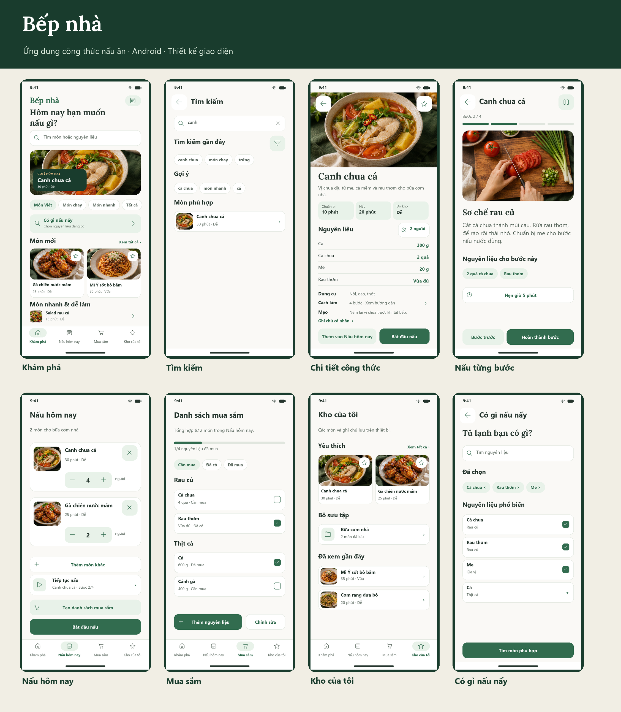

# Bàn giao dự án Android Ứng dụng công thức nấu ăn

Cập nhật ngày 11/11/2026. Dành cho nhóm ba thành viên.

**Thiết kế giao diện Android.** [Bàn giao UI/UX Bếp nhà](ui-ux-bep-nha/THIET_KE.md) có 28 màn hình chính, 22 biến thể, hệ thiết kế và luồng A–F. [Prototype PDF](ui-ux-bep-nha/prototype.pdf) cho phép nhấp chuyển giữa các màn mẫu. Bộ ảnh dùng để đối chiếu khi triển khai các module.

Tài liệu dựa trên lịch sử trao đổi trong cuộc trò chuyện này, tài liệu môn học đã đọc và kiểm tra workspace hiện tại. **Đã xác nhận** là yêu cầu hoặc hướng đi do người dùng nêu rõ. **Đề xuất** là phương án đã thảo luận để đặc tả hoặc triển khai. **Chưa xác minh** là hạng mục chưa có mã nguồn, cấu hình, nhật ký hoặc kết quả kiểm thử của đúng app để đối chiếu.

## A. Tổng quan và phạm vi

Tên đề tài trong hướng dẫn đã sửa là **Ứng dụng nấu ăn và công thức**, mã 08. Tên thương mại, tên project Android Studio và application ID chưa được xác nhận. App tiếng Việt hỗ trợ người dùng tìm món, tính lượng nguyên liệu, chuẩn bị mua sắm và theo dõi các bước nấu.

- **Người sử dụng app** tra cứu và nấu ăn không cần tài khoản. Món đã lưu, bộ sưu tập, ghi chú, lịch sử, kế hoạch hôm nay, danh sách mua sắm và tiến độ là dữ liệu cá nhân trên thiết bị.
- **Người quản lý nội dung** là thành viên có quyền quản lý dữ liệu trên Firebase. Phương án đã thảo luận là dùng Firebase Console để công bố, sửa và gỡ công thức. Quyền quản lý Firebase thuộc về nhóm dự án.
- **Firebase** cung cấp nội dung công khai. Món vừa công bố xuất hiện tự động trong **Món mới** sau khi app nhận và lưu được dữ liệu.
- **Phạm vi làm việc gần nhất** gồm chín module ở mục C. Đây là phạm vi kỹ thuật dùng để tiếp tục đặc tả, chưa có bằng chứng giảng viên đã duyệt.

Hướng dẫn môn yêu cầu nhóm 3 người, giảng viên xem xét nội dung trước khi nhóm thực hiện và mỗi thành viên phân tích, thiết kế, xây dựng tối thiểu một chức năng. Nhóm làm phần khung chung, tích hợp, bảo vệ dữ liệu cá nhân, viết báo cáo và bảo vệ. Tài liệu ghi báo cáo cuối kỳ 30% và bảo vệ cuối kỳ 30%. Mỗi phần có thang 10 điểm, phân bổ 3–4–3 cho giao diện, chức năng và tài liệu hoặc trình bày tương ứng.

Khung báo cáo yêu cầu trang bìa có phần việc chung, phần việc cá nhân và tổng tỷ lệ đóng góp 100%. Phần chung gồm lý do chọn đề tài, khảo sát ứng dụng tương tự, yêu cầu chức năng và phi chức năng, use case tổng quan, kiến trúc và công nghệ, phương thức lưu trữ, ERD hoặc cấu trúc bảng, điểm mới, điểm khó và hướng phát triển. Phần cá nhân trình bày luồng, ràng buộc, giao diện, giải pháp kỹ thuật, điểm mới, điểm khó và hướng mở rộng. Có thể dùng biểu đồ hoạt động để giải thích luồng phức tạp. Use case tổng quan và database thuộc thiết kế chung toàn hệ thống.

Bản hướng dẫn sửa liệt kê 15 nhóm tính năng. Phạm vi hiện tại bao phủ kho công thức Việt Nam và quốc tế, mua sắm, tìm kiếm, bộ lọc, chế độ nấu, yêu thích, khẩu phần, hẹn giờ và tiếng Việt. Video, chia sẻ qua mạng xã hội/email, góp ý và đánh giá, dinh dưỡng, diễn đàn và tích hợp giao hàng được đưa ra ngoài phạm vi bản đầu trong trao đổi. AI, thanh toán và đồng bộ tài khoản cũng nằm ngoài phạm vi. Việc chọn module optional xuất phát từ xác nhận của người dùng rằng có module tùy chọn. Danh mục cuối cùng vẫn cần đối chiếu với đề cương nhóm nộp.

Cookpad được khảo sát qua website Việt Nam, trang công thức, bài giới thiệu giao diện và mô tả Google Play. Các ý tưởng tham khảo gồm tìm theo nguyên liệu, tách nguyên liệu và các bước, bộ sưu tập và chọn món hôm nay. Những tính năng này đã có trên thị trường. Phần có thể trình bày khi bảo vệ là cách nhóm nối khẩu phần, mua sắm, tiến độ nấu và dữ liệu offline. [Cookpad Việt Nam](https://cookpad.com/vn/) · [Hướng dẫn giao diện](https://blog.cookpad.com/vn/kham-pha-giao-dien-moi-cua-cookpad/) · [Google Play](https://play.google.com/store/apps/details?id=com.cookpad.android.activities)

## B. Công nghệ và kiến trúc

| Hạng mục                      | Căn cứ hiện có                                                     | Việc cần xác nhận                                                                                                    |
| ----------------------------- | ------------------------------------------------------------------ | -------------------------------------------------------------------------------------------------------------------- |
| Java, Android Studio          | Đã xác nhận dùng Java; repo hiện là Android Java/Gradle            | Giữ Java và cấu trúc UI hiện có trong lúc refactor                                                                   |
| Gradle, AGP, JDK, Android SDK | Cấu hình thực tế nằm trong repo; minSdk 24, targetSdk 37, compileSdk 37 | Dùng Gradle Wrapper và JDK Android Studio đã build thành công; thay đổi baseline phải được review                 |
| Giao diện                     | Bốn mục điều hướng và 28 màn hình được đặc tả trong UI/UX           | Giữ thiết kế đã duyệt; responsive, không tự thay đổi bố cục hoặc luồng                                               |
| Firebase                      | Người dùng chọn Realtime Database và Firebase Storage              | Chốt schema, project, quyền đọc/ghi; app không đăng nhập                                                            |
| SQLite                        | Người dùng chọn giữ SQLite hiện có                                  | Dùng SQLiteOpenHelper; một người điều phối schema/migration và review thay đổi                                      |
| Kiến trúc                     | Người dùng chốt MVVM cho toàn bộ dự án                              | Đã tách bước đầu modules 5–6; tiếp tục từng module, giữ UI/flow                                                     |
| Dependency                    | Xác định theo Gradle hiện tại                                       | Thêm dependency theo nhu cầu module và review tác động build                                                        |

**Luồng dữ liệu thiết kế đang dùng để trao đổi** là nhóm quản lý công thức trên Firebase → app nhận nội dung công khai → lưu dữ liệu trên thiết bị → giao diện đọc dữ liệu đã lưu. Dữ liệu cá nhân được quản lý riêng trong lưu trữ cục bộ. Khi có mạng, app kiểm tra thay đổi lúc mở hoặc khi đang hoạt động. Khi mất mạng, app dùng nội dung đã tải. Ảnh offline cần cơ chế lưu riêng. Lịch cập nhật nền khi app đóng chưa được thống nhất.

## C. Đặc tả chín module

Các module và người phụ trách dưới đây đã được người dùng xác nhận theo bảng phân công. Trạng thái triển khai cập nhật tại mục G và K; không suy ra trạng thái code chỉ từ thiết kế. Kiến trúc toàn dự án đã chốt là MVVM; modules 5–6 đã được tách bước đầu, các module còn lại sẽ áp dụng khi triển khai/refactor.

| Module, mục đích và tác nhân                                                             | Luồng chính, đầu vào và đầu ra                                                                                                                                                               | Quy tắc và ngoại lệ cần đặc tả                                                                                                                                                                                                         | Thành phần liên quan                                                                        |
| ---------------------------------------------------------------------------------------- | -------------------------------------------------------------------------------------------------------------------------------------------------------------------------------------------- | -------------------------------------------------------------------------------------------------------------------------------------------------------------------------------------------------------------------------------------- | ------------------------------------------------------------------------------------------- |
| **1. Khám phá và danh mục**. Người dùng xem và mở món phù hợp.                           | Mở Khám phá → xem danh mục, Món mới, món nhanh hoặc dễ làm → chọn thẻ món. Đầu vào là kho đã tải và danh mục. Đầu ra là danh sách và công thức được chọn.                                    | Chỉ hiển thị món đã công bố. Món mới sắp theo ngày công bố. Khi tải lỗi, dùng dữ liệu đã có. Cần trạng thái rỗng, ảnh thay thế và quy tắc cho lần đầu mở offline.                                                                      | Trang Khám phá, thẻ món, dữ liệu công thức và danh mục từ module 9.                         |
| **2. Tìm kiếm và bộ lọc**. Người dùng tìm món theo tiêu chí.                             | Nhập tên có dấu hoặc không dấu hoặc chọn nguyên liệu → áp dụng thời gian, độ khó, chế độ ăn và nguyên liệu loại trừ → xem kết quả. Lưu lịch sử tìm kiếm trên máy.                            | Kết quả tuân theo các bộ lọc đang bật. Phân biệt dữ liệu nguyên liệu thiếu với dữ liệu đã khai báo đầy đủ. Chốt quy tắc xử lý từ khóa trống, không có kết quả và xóa lịch sử.                                                          | Màn hình tìm kiếm, dữ liệu tên món, nguyên liệu, nhãn và lịch sử.                           |
| **3. Chi tiết và điều chỉnh khẩu phần**. Người dùng xem nội dung và tính lượng cần dùng. | Chọn món → xem ảnh, mô tả, thời gian chuẩn bị/nấu, dụng cụ, nguyên liệu, bước và mẹo → nhập số người. Đầu ra là định lượng theo khẩu phần đã chọn.                                           | Lượng mới = lượng gốc × khẩu phần mới / khẩu phần gốc. Giữ nguyên công thức gốc, lượng định tính và thời gian nấu. Chặn đầu vào không hợp lệ. Giới hạn khẩu phần, làm tròn và cách hiển thị dữ liệu thiếu cần chốt.                    | Màn chi tiết, công thức, dòng nguyên liệu, bước nấu và phép tính dùng chung cho module 6–7. |
| **4. Nấu từng bước và hẹn giờ**. Người dùng làm theo hướng dẫn và tiếp tục phiên dở.     | Bắt đầu từ chi tiết hoặc Nấu hôm nay → xem bước và nguyên liệu liên quan → hẹn giờ nếu cần → đánh dấu hoàn thành → quay lại tiếp tục hoặc kết thúc. Đầu ra là tiến độ và trạng thái hẹn giờ. | Mỗi bước có thứ tự. Phiên lưu cục bộ. Cần xác định cách tạm dừng/hủy, hết giờ khi app xuống nền, khi quyền thông báo bị từ chối và khi công thức đổi trong phiên.                                                                      | Màn nấu, phiên nấu, tiến độ, hẹn giờ và thông báo nếu được cấp quyền.                       |
| **5. Kho món cá nhân**. Người dùng lưu và tìm lại món.                                   | Lưu/bỏ yêu thích, tạo bộ sưu tập, mở lịch sử xem, thêm hoặc sửa ghi chú. Đầu vào là mã món và nội dung cá nhân. Đầu ra là kho món trên thiết bị.                                             | Thao tác lưu lặp lại cần tránh bản ghi trùng. Xác định hành vi với tên bộ sưu tập trống/trùng, lịch sử rỗng và món đã gỡ. Giữ dữ liệu cá nhân khi đồng bộ kho.                                                                         | Màn Kho của tôi, yêu thích, bộ sưu tập, lịch sử, ghi chú.                                   |
| **6. Nấu hôm nay**. Người dùng chọn nhiều món cho một bữa.                               | Thêm hoặc bỏ món, đặt khẩu phần từng món, chuyển sang mua sắm hoặc bắt đầu nấu. Đầu ra là danh sách món và khẩu phần lưu cục bộ.                                                             | Mỗi món dùng khẩu phần đã chọn. Cần chốt cách xử lý thêm lại cùng món, kế hoạch rỗng và việc đổi khẩu phần sau khi đã tạo danh sách mua sắm.                                                                                           | Màn Nấu hôm nay, danh sách món, phép tính khẩu phần, điểm vào module 4 và 7.                |
| **7. Danh sách mua sắm**. Người dùng chuẩn bị phần nguyên liệu còn thiếu.                | Nhận món và khẩu phần → tổng hợp nguyên liệu → chỉnh lượng hoặc thêm mục thủ công → đánh dấu đã có, cần mua hoặc đã mua. Đầu ra là danh sách lưu cục bộ.                                     | Gộp cùng nguyên liệu khi đơn vị tương thích, chẳng hạn g và kg. Giữ riêng đơn vị không quy đổi được như g và ml khi thiếu dữ liệu. Giữ lượng định tính. Cần chốt hành vi tạo lại danh sách và cập nhật khi bỏ món để tránh cộng trùng. | Màn Mua sắm, quy đổi đơn vị, danh sách và từng mục mua sắm.                                 |
| **8. Gợi ý từ nguyên liệu sẵn có**. Người dùng tìm món từ thứ đang có.                   | Chọn nguyên liệu → so khớp với công thức → xem món kèm phần đã có và còn thiếu. Ưu tiên món thiếu ít nguyên liệu hơn.                                                                        | Bản đầu đối chiếu có/không, chưa quản lý lượng tồn. Cần chốt thứ tự khi đồng hạng, khi không chọn nguyên liệu, khi không có món phù hợp và khi công thức thiếu thông tin.                                                              | Mục Có gì nấu nấy, dữ liệu nguyên liệu, quy tắc đối chiếu và xếp hạng.                      |
| **9. Cập nhật kho và offline**. Nhóm quản lý nội dung. Người dùng nhận bản cập nhật.     | Nhóm kiểm tra và công bố nội dung trên Firebase → app nhận công thức mới, sửa hoặc gỡ → cập nhật SQLite → làm mới Món mới và các danh sách.                                                  | Mã công thức ổn định. Tách thời điểm công bố khỏi chỉnh sửa. Chỉ cấp quyền ghi cho nhóm. Giữ dữ liệu cá nhân khi cập nhật. Cần đặc tả lỗi tải, lần tải lại, dữ liệu không hợp lệ và gỡ nội dung.                                       | Firebase, lưu trữ SQLite, bộ cập nhật kho, giao diện Khám phá và trạng thái kết nối.        |

Use case tổng quan lấy người dùng app làm tác nhân chính. Hành vi công bố nội dung có thể mô tả trong ranh giới hệ thống rộng hơn nếu bao gồm Firebase Console. ERD và biểu đồ use case hoàn chỉnh chưa có trong các tệp đã kiểm tra.

## D. Thiết kế cơ sở dữ liệu

Chưa có schema nội dung công thức, migration, hoặc dữ liệu Firebase được tích hợp. Phần SQLite cá nhân của module 5 hiện đã có code khởi tạo các bảng `Favorite`, `Collection`, `CollectionRecipe`, `RecipeNote`, `RecipeViewHistory` và `LocalMeta` trong `PersonalDataDbHelper`; `assembleDebug` thành công và app đã mở được trên emulator Android 16. Bảng dưới vẫn là **bản phác thảo** cho các phần chưa tích hợp; hợp đồng chung được đề xuất riêng trong [THONG_NHAT_DU_LIEU_MODULE_5_7.md](THONG_NHAT_DU_LIEU_MODULE_5_7.md) và đang chờ nhóm xác nhận.

| Thực thể đã thảo luận                   | Thuộc tính và kiểu gợi ý                                                                                                              | Khóa, quan hệ và ràng buộc đề xuất                                                                                                                                                            |
| --------------------------------------- | ------------------------------------------------------------------------------------------------------------------------------------- | --------------------------------------------------------------------------------------------------------------------------------------------------------------------------------------------- |
| `Recipe`                                | Mã ổn định TEXT, tên TEXT, mô tả TEXT, khẩu phần gốc INTEGER, thời gian chuẩn bị/nấu INTEGER, độ khó TEXT, ngày công bố/chỉnh sửa INTEGER | Mã món là PK. Khẩu phần gốc thuộc `1..999`. Thời gian không âm. Cần chốt biểu diễn công bố/gỡ.                                                                                                |
| `Category`                              | Mã và tên TEXT                                                                                                                        | Mã danh mục là PK. Người dùng đã chốt một công thức có thể thuộc nhiều danh mục; dùng bảng liên kết `RecipeCategory` với khóa duy nhất theo cặp.                                                   |
| `Ingredient`                            | Mã và tên chuẩn TEXT                                                                                                                  | Mã nguyên liệu là PK. Mã chuẩn giúp tìm kiếm và gộp mua sắm.                                                                                                                                  |
| `RecipeIngredient`                      | Mã dòng, mã món, mã nguyên liệu TEXT, lượng số có thể rỗng, đơn vị và ghi chú TEXT                                                    | Mã dòng là PK đề xuất. Hai FK liên kết `Recipe` và `Ingredient`, biểu diễn quan hệ nhiều–nhiều. Cho phép nguyên liệu xuất hiện ở nhiều công đoạn. Chốt biểu diễn số lượng và lượng định tính. |
| `CookingStep`                           | Mã bước, mã món, nội dung TEXT, thứ tự và thời lượng gợi ý INTEGER                                                                    | PK mã bước, FK món. Thứ tự duy nhất trong món. Liên kết nguyên liệu theo bước nếu cần hiển thị ở module 4.                                                                                    |
| `Favorite`                              | Mã món TEXT, thời điểm lưu INTEGER                                                                                                    | Mỗi mã món có tối đa một lượt lưu trong kho cục bộ. Chốt cách giữ dữ liệu khi công thức bị gỡ.                                                                                                |
| `ShoppingList`, `ShoppingListItem`      | Mã danh sách/mục TEXT, mã nguyên liệu tùy chọn, tên nhập tay TEXT, lượng, đơn vị TEXT, danh mục, trạng thái TEXT                                | Danh sách 1–n mục. Cho phép mục thủ công. Cần giữ nguồn món hoặc quy tắc cập nhật tương đương nếu hỗ trợ tạo lại danh sách.                                                                   |
| `CookingSession`, `CookingStepProgress` | Mã phiên/món/bước TEXT, trạng thái TEXT, thời điểm INTEGER                                                                            | Phiên 1–n bản ghi bước. Chốt khóa, lưu hẹn giờ và cách giữ phiên đang nấu khi nội dung đổi.                                                                                                   |

Trong code hiện tại, bộ sưu tập, ghi chú, lịch sử xem gần đây đã có bảng cục bộ nêu trên. Món trong Nấu hôm nay, danh sách mua sắm, nhãn chế độ ăn, ảnh và hẹn giờ chưa được tích hợp. Dữ liệu gợi ý nguyên liệu có thể tính từ kho công thức và lựa chọn hiện tại, tùy quyết định có lưu lựa chọn hay không.

**CRUD theo hướng đã thảo luận.** Nhóm quản lý tạo, sửa, công bố hoặc gỡ công thức ở Firebase. App đọc nội dung công khai, tạo/cập nhật bản sao SQLite và phản ánh việc gỡ trên giao diện. Người dùng tạo, đọc, sửa và xóa dữ liệu cá nhân trên thiết bị. Module 5 hiện dùng `SQLiteOpenHelper`; chưa có tích hợp Firebase, DAO riêng hoặc luồng giữ snapshot khi món bị gỡ. Khuyến nghị áp dụng một lần cập nhật kho trong giao dịch SQLite khi nội dung liên quan phải nhất quán, và thống nhất cách giữ liên kết tới món đã gỡ trước khi bật xóa dây chuyền.

## E. Mã nguồn và điều hướng

Người dùng xác nhận nhóm cùng làm trên repo hiện tại `Android-Project`. Đây là project Android Java/Gradle với package `com.example.myapplication`. `MainActivity` giữ phần render UI và điều hướng; module 5/6/7 hiện dùng `PersonalDataViewModel`/`MealPlanViewModel`/`ShoppingViewModel` và `PersonalDataRepository` để tách xử lý/truy cập dữ liệu khỏi Activity. SQLite nằm trong `PersonalDataDbHelper`. Module 6 có chọn/bỏ món, khẩu phần riêng, lưu kế hoạch nguyên tử, khôi phục bản nháp và giới hạn 1–999; build cùng instrumentation tests cần kiểm tra theo commit mới. Module 5 có Kho của tôi, Yêu thích, Bộ sưu tập, tạo/sửa bộ sưu tập, Ghi chú và SQLite. Nội dung món trong ảnh thiết kế được nạp như fixture preview chỉ trong debug; không phải dữ liệu Firebase thật. Module 7 hiện có danh sách cục bộ và mục nhập tay (thêm/sửa/xóa, xóa toàn bộ sau xác nhận, hai trạng thái `Cần mua`/`Đã có` chuyển bằng nút tích, Hoàn tác sau đổi trạng thái, chuẩn hóa đơn vị, nhóm danh mục và phát hiện thay đổi kế hoạch với sheet màn 22). Form không cho chọn trạng thái: mục mới mặc định `Cần mua`, tự thành `Đã có` nếu lượng pantry đã biết, chưa quá hạn và đủ theo yêu cầu; mục đang sửa giữ trạng thái cũ. Tạm ghép tên chính xác sau chuẩn hóa dấu/khoảng trắng khi chưa có ingredientId; dùng ingredientId khi có. `Đã có` trong danh sách mua sắm nghĩa là nguyên liệu người dùng xác nhận đang có; không có trạng thái `Đã mua`. Tủ nguyên liệu không có trạng thái tồn kho nhập tay: trạng thái được tính từ hạn dùng thành `Sử dụng được`/`Sắp hết hạn`/`Hết hạn`; lượng trống là chưa biết lượng và ngày mua là tùy chọn. SQLite schema 10 loại cột trạng thái thủ công cũ và giữ lại dữ liệu pantry còn lại. Sheet màn 22 hiện ghi nhận kế hoạch mới và giữ mục nhập tay; chưa tổng hợp nguyên liệu công thức hay chênh lệch định lượng vì kho công thức chưa cung cấp dòng nguyên liệu. Không tạo dữ liệu công thức giả. Tích hợp nội dung công thức/Firebase chưa hoàn chỉnh. MVVM là kiến trúc mục tiêu toàn dự án; phần 5/6/7 đang được tách theo ViewModel/Repository; các module còn lại chưa có đầy đủ code. Responsive UI áp dụng cho mọi kích thước/mật độ, xoay màn hình, system insets và IME; giữ thiết kế và cuộn nội dung khi viewport hẹp. Một số trạng thái ghi chú từng được đối chiếu trên emulator 411×914dp; chưa phải QA đầy đủ trên nhiều viewport/thiết bị thật. Cold start từng mở thành công trên emulator Android 16. Kiểm tra kết quả build/test mới nhất phải theo từng commit.

Luồng điều hướng **đề xuất đã trao đổi** có bốn mục chính.

- **Khám phá** → danh mục/tìm kiếm/gợi ý → chi tiết công thức.
- **Chi tiết công thức** → lưu món, đổi khẩu phần, thêm vào Nấu hôm nay hoặc bắt đầu nấu.
- **Nấu hôm nay** → chỉnh khẩu phần từng món → Mua sắm hoặc Nấu từng bước.
- **Mua sắm** → theo dõi nguyên liệu. **Kho của tôi** → mở lại chi tiết món.

Hợp đồng tích hợp đề xuất là truyền mã công thức ổn định giữa các màn hình và truyền khẩu phần hoặc đọc khẩu phần đã lưu khi lập danh sách và mở phiên nấu. Module 3, 6 và 7 dùng cùng quy tắc định lượng. Module 1, 2, 3 và 8 dùng chung kho nội dung cục bộ. Hành vi của phiên đã bắt đầu khi nội dung công thức được sửa còn cần quyết định.

## F. Phân công và Git

Nhóm có ba người; theo xác nhận người dùng, phân công chín module dưới đây là phân công làm việc hiện hành. Mỗi người phụ trách phân tích, đặc tả, UI theo thiết kế chung, dữ liệu, lập trình, kiểm thử và nội dung báo cáo của module mình; use case tổng quan và schema chung do cả nhóm hợp nhất. Phạm vi cuối cùng vẫn phải khớp đề cương giảng viên đã duyệt.

| Người   | Module phụ trách                                                                | Giao diện tích hợp cần bàn giao                                               |
| ------- | ------------------------------------------------------------------------------ | ----------------------------------------------------------------------------- |
| Người 1 | 1 Khám phá, 2 Tìm kiếm và bộ lọc, 8 Gợi ý nguyên liệu                          | Danh mục, dữ liệu cần tra cứu, mã công thức để mở chi tiết                    |
| Người 2 | 3 Chi tiết và khẩu phần, 4 Nấu từng bước và hẹn giờ, 9 Cập nhật kho và offline | Mô hình công thức cục bộ, phép tính khẩu phần, trạng thái cập nhật, phiên nấu |
| Người 3 | 5 Kho món, 6 Nấu hôm nay, 7 Mua sắm                                            | Mã món lưu cục bộ, kế hoạch và khẩu phần, danh sách nguyên liệu               |

Module 4 và 9 có rủi ro khối lượng cao. Trong phương án này, cả nhóm cùng chuẩn bị dữ liệu mẫu và đối chiếu schema. Người 1 tham gia kiểm thử cập nhật Món mới, Người 3 tham gia kiểm thử việc giữ dữ liệu cá nhân sau đồng bộ. Tỷ lệ đóng góp ghi theo phần việc thực tế, tổng 100%.

Use case tổng quan và database do cả nhóm hợp nhất từ đặc tả từng module. Phải thống nhất sớm mã công thức/nguyên liệu, quy tắc đơn vị, cấu trúc dữ liệu và điều hướng. Các điểm dễ xung đột khi merge là điều hướng chung, resource giao diện, cấu hình Gradle, schema/migration và dữ liệu mẫu.

Người dùng xác nhận cả nhóm cùng làm trên repo `Android-Project`: mỗi người dùng branch riêng, tích hợp qua Pull Request và có AI review. Không push nếu người dùng chưa yêu cầu rõ. Cần chỉ định người điều phối app shell/navigation và schema/migration; thay đổi file dùng chung phải được review. Quy tắc phối hợp chi tiết ở mục K.

## G. Tiến độ

Người phụ trách dùng phân công đã được người dùng xác nhận ở mục F. Trạng thái dưới đây là trạng thái **triển khai**, không suy ra từ thiết kế.

| Module/Công việc                 | Người phụ trách | Đã hoàn thành                                           | Còn thiếu                                            | Trạng thái                     | Bước tiếp theo                               |
| -------------------------------- | --------------- | ------------------------------------------------------- | ---------------------------------------------------- | ------------------------------ | -------------------------------------------- |
| 1. Khám phá                      | Người 1         | Mô tả phạm vi và Món mới                                | Thiết kế màn, nguồn dữ liệu, mã và test cần xác minh | Chưa đủ thông tin để xác định  | Chốt cấu trúc thẻ món và quy tắc Món mới     |
| 2. Tìm kiếm/bộ lọc               | Người 1         | Chốt nhóm tiêu chí ở mức yêu cầu                        | Đặc tả truy vấn, trạng thái rỗng, mã và test         | Chưa đủ thông tin để xác định  | Lập bộ dữ liệu kiểm tra tiếng Việt và bộ lọc |
| 3. Chi tiết/khẩu phần            | Người 2         | Có ví dụ đặc tả và công thức tính                       | Ràng buộc khẩu phần, làm tròn, giao diện, mã và test | Chưa đủ thông tin để xác định  | Chốt quy tắc định lượng dùng chung           |
| 4. Nấu/hẹn giờ                   | Người 2         | Mô tả bước, phiên và hẹn giờ                            | Trạng thái phiên, xử lý nền, mã và test              | Chưa đủ thông tin để xác định  | Vẽ luồng và đặc tả khôi phục                 |
| 5. Kho cá nhân                   | Người 3         | UI 13–17, SQLite, ViewModel/Repository, lịch sử tối đa 10 recipeId khác nhau có nút yêu thích, nút sao tại thẻ món trong ghi chú, tìm kiếm có dấu/không dấu trong Yêu thích, chi tiết bộ sưu tập và form tạo/sửa, trạng thái yêu thích rỗng, tối đa 5 bộ sưu tập xem trước + màn xem tất cả, nút sửa/xóa bộ sưu tập có nhãn; nhật ký theo món và màn tổng hợp tìm kiếm/lọc ngày/lọc sao/thống kê, lưu cục bộ, ảnh tùy chọn | recipeId và nội dung công thức thật; điểm vào tự động từ Module 4; sau khi module công thức/cách nấu sẵn sàng thì cập nhật màn ghi chú để hiển thị nội dung đó cùng ghi chú cá nhân; backup/export-import sau khi schema ổn định; responsive QA đa viewport | Build và 9 instrumentation tests qua trên Pixel 7 AVD / Android 17; bộ lọc ngày có nút X xóa từng ngày và rời màn tổng hợp sẽ xóa khoảng ngày; chưa kiểm tra responsive nhiều kích thước | Tiếp tục QA UI và regression sau tích hợp công thức |
| 6. Nấu hôm nay                   | Người 3         | Chọn/bỏ món, khẩu phần riêng, nguồn món từ danh sách hiện có/yêu thích/một bộ sưu tập, giữ lựa chọn khi đổi nguồn, transaction, draft restoration, ViewModel/Repository, migration 1–999; thứ tự nấu được lưu bền vững, xóa có Hoàn tác, tổng thời lượng ước tính có nêu giới hạn | Hợp đồng với 3/4/7, recipeId thật, responsive QA đa viewport | Build và 7 instrumentation tests qua trên Pixel 7 AVD / Android 17; chưa kiểm tra responsive nhiều kích thước | QA thêm luồng tương tác/IME và regression sau tích hợp |
| 7. Mua sắm                       | Người 3         | Màn danh sách và form thêm/sửa/xóa; SQLite; nhóm danh mục; lọc hai trạng thái; trạng thái mục mới tự đối chiếu pantry, mục sửa giữ trạng thái; chuẩn hóa đơn vị; nhận biết thay đổi kế hoạch và sheet màn 22; tủ nguyên liệu cục bộ với tìm kiếm/lọc/thêm/sửa/xóa, lượng decimal tùy chọn, trạng thái hạn dùng tự tính, ngày mua tùy chọn và xác nhận xóa toàn bộ | Nối ingredientId và dòng nguyên liệu công thức thật; responsive QA đa viewport | Build, assemble và 25 instrumentation tests qua trên Pixel 7 AVD / Android 17; có test auto-match pantry, migration schema 8/9, hạn dùng và xóa toàn bộ | QA thao tác giao diện và tích hợp sinh danh sách khi kho công thức cung cấp thành phần |
| 8. Gợi ý nguyên liệu             | Người 1         | Phân biệt với tìm kiếm thông thường                     | Chốt xếp hạng và ngoại lệ, mã và test                | Chưa đủ thông tin để xác định  | Viết ví dụ có/thiếu nguyên liệu              |
| 9. Cập nhật/offline              | Người 2         | Hướng Firebase → SQLite → Món mới                       | Project Firebase, quyền, schema, mã và test          | Chưa đủ thông tin để xác định  | Chốt hợp đồng nội dung và luồng cập nhật     |
| Use case tổng quan và database   | Cả nhóm         | Có nhóm tác nhân, thực thể và phương pháp phân tích     | Biểu đồ, schema chính thức, review liên module       | Đang thực hiện ở mức phân tích | Hợp nhất đặc tả từ chín module               |
| Khảo sát và báo cáo              | Cả nhóm         | Đã đọc tài liệu, đối chiếu Cookpad và nắm khung báo cáo | Báo cáo nhóm/cá nhân và tỷ lệ thực tế                | Đang thực hiện ở mức chuẩn bị  | Liên kết yêu cầu với thiết kế, mã và test    |
| Build, tích hợp, APK và kiểm thử | Cả nhóm         | `assembleDebug` đạt; cold start mở trên emulator Android 16 | Tích hợp toàn app, kiểm tra đầy đủ luồng và thiết bị thật | Đang thực hiện                 | Đối chiếu các luồng module 5 và kiểm tra trên máy thật |

## H. Lỗi và vấn đề đã ghi nhận

| Vấn đề                           | Triệu chứng                                                                          | Nguyên nhân hoặc căn cứ                                                                     | Xử lý đã thực hiện                                                                                   | Trạng thái                                               |
| -------------------------------- | ------------------------------------------------------------------------------------ | ------------------------------------------------------------------------------------------- | ---------------------------------------------------------------------------------------------------- | -------------------------------------------------------- |
| Nội dung đề tài bản cũ mâu thuẫn | Tiêu đề là app công thức nhưng danh sách chức năng mô tả phòng chat và nhóm sở thích | Phần mô tả trong bản cũ không khớp đề tài. Nguyên nhân biên tập sâu hơn chưa được xác định. | Người dùng sửa file hướng dẫn. Đọc lại bản sửa có công thức, video, mua sắm và các chức năng nấu ăn. | Đã khắc phục trong tài liệu.                             |
| Khó xác nhận project triển khai  | Ban đầu workspace chỉ có tài liệu và nhiều repo lân cận                       | Repo app công thức chưa được nhận diện trong lượt kiểm tra đầu                                   | Người dùng xác nhận repo dùng chung là `Android-Project`; tiếp tục làm trực tiếp trong repo hiện tại | Đã xác định repo làm việc; không dùng ghi chú repo cha cũ. |
| App dừng ngay khi mở             | `MainActivity` crash khi khởi tạo dữ liệu preview; log báo `RecipeNote` không có cột `duration` | Hàm ghi chú dùng chung `recipeValues()` và gửi cả `duration`, `difficulty` vào bảng chỉ có `recipeId`, `title`, `imageRes`, `note`, `updatedAt`. | Tạo `noteValues()` đúng trường; build, cài lại và mở app trên emulator. | Đã khắc phục; cold start mở được sau khi reboot emulator. |

Lịch sử được cung cấp chưa có lỗi Android Studio/Gradle, lỗi lập trình, database, giao diện hoặc tích hợp của đúng app kèm triệu chứng, nguyên nhân và bản sửa đã xác minh. Các tình huống mất mạng, món bị gỡ, định lượng không hợp lệ, hết giờ và xung đột khi merge là hạng mục kiểm thử hoặc thiết kế, chưa phải lỗi đã xảy ra.

## I. Quyết định và thay đổi

| Chủ đề                 | Phương án trước                                               | Trạng thái gần nhất                                                                                                                                                             |
| ---------------------- | ------------------------------------------------------------- | ------------------------------------------------------------------------------------------------------------------------------------------------------------------------------- |
| Đề tài                 | Bản cũ lẫn mô tả cộng đồng/chat                               | Bản sửa và người dùng xác nhận app tập trung vào món ăn                                                                                                                         |
| Phạm vi                | 15 nhóm chức năng trong hướng dẫn, rồi đề xuất MVP tám module | Phạm vi làm việc mới nhất gồm chín module. Bổ sung Nấu hôm nay, gợi ý nguyên liệu, cập nhật/offline. Gộp chế độ nấu với hẹn giờ, khẩu phần với chi tiết, và tìm kiếm với bộ lọc |
| Tài khoản              | Cân nhắc tài khoản để đồng bộ và quản lý                      | Người dùng nêu app dự định không cần đăng nhập. Dữ liệu cá nhân lưu trên máy trong phương án thiết kế hiện tại                                                                  |
| Nội dung               | Cân nhắc kho cài sẵn hoặc công cụ quản trị                    | Người dùng yêu cầu cập nhật món trên Firebase và tự đưa vào Món mới. Firebase Console và SQLite là cách triển khai đã thảo luận                                                 |
| Món mới                | Chưa có tiêu chí sắp xếp cụ thể                               | Bản tổng hợp gần nhất đề xuất sắp theo ngày công bố và giữ ngày chỉnh sửa riêng                                                                                                 |
| Trách nhiệm            | Chia theo luồng hoặc chuyên môn                               | Người dùng yêu cầu chia theo module, mỗi người phân tích và thiết kế phần mình. Use case tổng quan và database được tổng hợp chung                                              |
| Kiến trúc, Git, schema | Chưa chốt | Người dùng chốt MVVM toàn dự án, giữ Java/UI, branch riêng + PR + AI review, và một người điều phối schema. Schema chi tiết cùng người giữ app shell/schema cần nhóm phân công. |

## J. Kế hoạch phát triển

1. **Xác định project chính thức và phạm vi nộp.** Đối chiếu đường dẫn repo nếu nhóm đã có mã. Gắn tên thật vào phân công và ghi nhận module optional trong đề cương giảng viên xem xét.
2. **Đặc tả và thiết kế chung.** Viết luồng chính, ngoại lệ, đầu vào/ra và quy tắc của từng module. Hợp nhất use case, ERD, hợp đồng nội dung Firebase và điều hướng. Chốt quy tắc công bố/gỡ món, mã định danh, đơn vị, khẩu phần và quyền đọc/ghi.
3. **Thiết lập hoặc xác minh baseline.** Chốt cấu hình Android Studio/Gradle/SDK, phương pháp giao diện, kiến trúc, dependency, SQLite và cách nạp dữ liệu ban đầu. Build app khung và chạy trên môi trường demo.
4. **Tích hợp theo thứ tự phụ thuộc.** Hoàn thành kho công thức và cập nhật thử cùng màn Khám phá/Chi tiết. Tiếp theo ghép tìm kiếm, gợi ý, kho cá nhân, khẩu phần, Nấu hôm nay và mua sắm. Ghép chế độ nấu/hẹn giờ trên cùng mã công thức và dữ liệu bước.
5. **Kiểm thử theo đặc tả.** Kiểm tra công bố, sửa, gỡ món, mất mạng và kết nối lại. Kiểm tra tìm tiếng Việt có/không dấu, lọc và gợi ý với dữ liệu thiếu. Kiểm tra khẩu phần bằng 0, số âm, làm tròn, lượng định tính, gộp g/kg và giữ riêng g/ml. Thử tạo lại danh sách để phát hiện cộng trùng. Thử đóng/mở, đưa app xuống nền và quay lại phiên nấu, cùng tình huống dữ liệu cá nhân còn nguyên sau cập nhật. Ghi kết quả mong đợi và kết quả thực tế.
6. **Bàn giao và bảo vệ.** Tạo APK sau khi build và kiểm thử, chuẩn bị dữ liệu demo và kịch bản xuyên suốt từ món mới đến hoàn tất phiên nấu. Báo cáo nhóm có use case tổng quan và ERD/cấu trúc bảng, mỗi người có ít nhất một chức năng chạy được và giải thích được phần mình. Ghi tổng đóng góp 100%.

## K. Quyết định thống nhất và quy tắc cộng tác (20/11/2026)

> Mục này ghi nhận lựa chọn của người dùng cho nhóm. “Đã chốt” là lựa chọn đã được người dùng xác nhận; “Đề xuất vận hành” là cách xử lý được chọn theo quyền người dùng giao, có thể được nhóm xem xét nhưng không được trình bày nhầm thành yêu cầu giảng viên. “Chờ nhóm” là hợp đồng cần người phụ trách liên quan đồng thuận trước khi dùng trong tích hợp. Mục này cập nhật và thay thế các ghi chú cũ trái ngược ở mục B, E, F, G, I.

### K.1. Phạm vi, công nghệ và kiến trúc

- **Đã chốt:** dùng phạm vi chín module 1–9 trong mục C; phân công đúng bảng mục F. Người dùng phụ trách Người 3 (module 5, 6, 7). Không cần lưu tên thật thành viên trong hướng dẫn làm việc.
- **Đã chốt:** Java, repo Android hiện tại, giữ công nghệ giao diện và thiết kế hiện có. Không tự thay UI, nhãn, bố cục hoặc luồng đã duyệt; responsive là yêu cầu toàn dự án cho kích thước, mật độ, xoay màn hình, system insets và bàn phím.
- **Đã chốt:** MVVM cho toàn bộ app, bao gồm chuyển đổi code hiện có. Refactor phải giữ nguyên hành vi và UI/UX đã duyệt; chia thành thay đổi nhỏ, build/test sau mỗi phần, không trộn refactor lớn với thay đổi tính năng.
- **Đã chốt:** Realtime Database cho dữ liệu công thức và Firebase Storage cho ảnh. Tài khoản người dùng không nằm trong phạm vi hiện tại.
- **Đã chốt:** giữ SQLite/`SQLiteOpenHelper` hiện tại, không chuyển sang Room ở thời điểm này. Một người được nhóm chỉ định làm điều phối schema/migration; mọi thay đổi bảng, khóa, migration phải được review trước khi merge.
- **Baseline quan sát được:** application ID `com.example.myapplication`, minSdk 24, targetSdk 37, compileSdk 37. Dùng Gradle Wrapper và JDK Android Studio đã build thành công; không tự đổi baseline hoặc thêm thư viện mà không nêu lý do và kiểm tra tác động.
- **Còn thiếu thông tin cấu hình, không chặn đặc tả:** Firebase project URL/region, cấu trúc node, schema cuối, rules, tên bucket Storage và người giữ quyền quản trị. Không đưa secret/service account vào repo hoặc APK.

### K.2. Firebase, offline và quyền ghi

- App không đăng nhập; theo đề xuất an toàn được người dùng giao quyền lựa chọn, app người dùng chỉ đọc nội dung đã công bố. Nhóm quản lý cập nhật nội dung bằng Firebase Console hoặc công cụ quản trị có quyền riêng. Không bật ghi công khai từ app không xác thực; nếu sau này cần app client có quyền ghi thì phải thống nhất cơ chế xác thực và rules trước.
- Đồng bộ theo lựa chọn người dùng: khi mở app hoặc khi app đang hoạt động; không yêu cầu lịch nền khi app đóng.
- **Khi đồng bộ thất bại (đề xuất vận hành được chọn):** giữ nguyên snapshot local hợp lệ gần nhất; không ghi một phần kết quả tải mới; hiện trạng thái lỗi không chặn người dùng tiếp tục dùng dữ liệu offline; cung cấp thử lại theo UI/UX. Log kỹ thuật không chứa dữ liệu nhạy cảm. Chỉ cập nhật local sau khi dữ liệu mới đã tải và qua kiểm tra hợp lệ.
- Nội dung mới/sửa/gỡ cần giữ `recipeId` ổn định. Gỡ khỏi kho công khai không tự xóa yêu thích, bộ sưu tập, ghi chú, kế hoạch, mua sắm hoặc phiên nấu; giữ snapshot hiển thị tối thiểu khi cần. Cách hiển thị chính xác từng loại dữ liệu theo thiết kế và hợp đồng module.

### K.3. Hợp đồng dữ liệu liên module

- **Đã chốt:** `recipeId` là ID Firebase dạng chuỗi ổn định, không tạo từ tên món. **Đã chốt:** dùng danh mục `ingredientId` chuẩn chung; alias chỉ trỏ về cùng ID khi nhóm xác nhận quan hệ đồng nghĩa.
- **Đã chốt:** công thức có thể thuộc nhiều danh mục; dùng quan hệ nhiều-nhiều, không nhồi một danh mục duy nhất vào Recipe.
- **Đã chốt:** phép tính định lượng dùng `BigDecimal`, công thức `lượng gốc × khẩu phần đã chọn / baseServings`; giữ lượng gốc, chỉ làm tròn để hiển thị tới 2 chữ số thập phân. Lượng định tính giữ nguyên, không nhân; thời gian nấu không tự đổi theo khẩu phần.
- **Đã chốt giới hạn khẩu phần 1–999:** áp dụng chung cho module 3, 6, 7. SQLite và giao diện module 6 phải chặn ngoài miền này. Migration giữ nguyên kế hoạch cũ và đổi constraint từ 1–99 sang 1–999.
- Mỗi món chỉ có một dòng trong kế hoạch; thêm lại không tạo bản trùng. Từng món lưu khẩu phần riêng. Màn thêm món mới mở với 1; bộ đếm hiện tại áp dụng cho món mới được chọn trong lần xác nhận đó. Món đã có trong kế hoạch giữ khẩu phần riêng trừ khi người dùng chỉnh trực tiếp dòng món.
- Dùng một hợp đồng dữ liệu/API công khai giữa module; không để module gọi thẳng Activity nội bộ của module khác. Điểm vào chi tiết, lập kế hoạch, mua sắm và nấu nhận ID ổn định cùng dữ liệu cần thiết qua lớp điều phối/ViewModel/Repository theo MVVM.

### K.4. Danh mục đơn vị và quy đổi

- Dùng đơn vị phù hợp bản chất nguyên liệu/cách nấu, không ép mọi nguyên liệu về g hoặc ml. Gia vị có thể là muỗng cà phê/muỗng canh; nguyên liệu đếm được dùng quả, tép, nhánh, bó, gói… Đơn vị định tính như “một ít/nhúm/vừa đủ” phải phân biệt với lượng số.
- Danh mục chuẩn do người dùng cung cấp: **khối lượng** `MG` (mg), `G` (g), `KG` (kg), `OZ` (oz), `LB` (lb); **thể tích** `ML` (ml), `L` (l), `TSP` (tsp), `TBSP` (tbsp), `CUP` (cup), `FLOZ` (fl oz); **đếm/đóng gói** `PCS` (cái), `ITEM` (đơn vị), `PIECE` (miếng), `SLICE` (lát), `CLOVE` (tép), `BULB` (củ), `BUNCH` (bó), `SPRIG` (nhánh), `LEAF` (lá), `EGG` (quả), `CAN` (lon), `BOTTLE` (chai), `PACK` (gói), `BOX` (hộp), `BAG` (túi), `STICK` (thanh), `PINCH` (nhúm), `DASH` (một ít); **đơn vị nấu Việt Nam** `MUONG_CA_PHE`, `MUONG_CANH`, `BAT`, `CHEN`, `TO`, `LY`, `COC`, `DIA`, `NAM`, `NHUM`, `LAT`, `KHOANH`, `KHUC`, `QUA`, `TRAI` với tên hiển thị tương ứng muỗng cà phê, muỗng canh, bát, chén, tô, ly, cốc, đĩa, nắm, nhúm, lát, khoanh, khúc, quả, trái.
- Quy đổi đã cung cấp: 1.000 mg = 1 g; 1.000 g = 1 kg; 1 oz = 28,3495 g; 1 lb = 453,592 g; 1.000 ml = 1 l; 1 tsp = 4,929 ml; 1 tbsp = 14,787 ml; 1 cup = 236,588 ml; 1 fl oz = 29,574 ml. Thể tích muỗng/cup theo US customary. Hệ số lưu dạng decimal chính xác.
- Không mặc định quy đổi khối lượng↔thể tích; chỉ cho phép khi có mật độ riêng theo `ingredientId`. Bát/chén/tô/ly/cốc không quy đổi sang ml khi chưa có dung tích chuẩn. Nhúm không quy đổi sang gram nếu chưa có định lượng nguyên liệu cụ thể. Đơn vị đếm chỉ gộp khi cùng unit hoặc có alias/ngữ cảnh được nhóm xác nhận.
- Alias được chấp nhận theo danh mục người dùng cung cấp: gram/grams/gr/gam→g; kilogram/kilograms/kilo/ký→kg; milligram/milli→mg; milliliter/millilitre/cc→ml; liter/litre→l; teaspoon/tea spoon→tsp; muỗng cafe/thìa cà phê→muỗng cà phê; muỗng canh/thìa canh→muỗng canh; tablespoon/table spoon→tbsp; cup/cups→cup; quả/trái chỉ cùng chuẩn khi nghiệp vụ xác nhận; cái/chiếc chỉ cùng chuẩn khi nghiệp vụ xác nhận; “tép/nhánh tỏi”→tép chỉ khi biết ngữ cảnh là tỏi; bó/bunch→bó.
- Danh mục này là baseline; module 7 và chủ sở hữu schema phải mã hóa thành bảng units, aliases, conversions thay vì rải quy đổi trong UI. Trước khi merge, người điều phối schema xác nhận khóa, nhóm đại lượng, hệ số, alias và ngoại lệ nguyên liệu.

### K.5. Quy tắc nghiệp vụ cho module

- **Module 1:** món mới xếp theo thời điểm công bố; sửa món không làm món cũ nổi lại. Dùng trạng thái lỗi/offline/loading đã có trong UI/UX.
- **Module 2:** kết hợp nhiều bộ lọc bằng AND; lưu lịch sử tìm kiếm 1 giờ. Chi tiết truy vấn, debounce và thông báo rỗng do người phụ trách module 2 quyết định, miễn giữ UI/UX đã duyệt.
- **Module 3:** hiển thị hai chữ số thập phân, làm tròn ở bước hiển thị; lượng nhỏ ưu tiên đơn vị nấu ăn trong danh mục K.4. Giới hạn khẩu phần và cách xử lý đầu vào ngoài miền phải thống nhất với hợp đồng chung trước khi tích hợp.
- **Module 4:** trạng thái phiên, nhiều timer, pause/cancel, background notification và khôi phục phiên do người phụ trách module 4 đặc tả sau; phải giữ màn/state theo UI/UX và dùng recipeId/servings chung.
- **Module 5 – lịch sử, ghi chú, bộ sưu tập và điều hướng:** lịch sử xem lưu cục bộ trên thiết bị tối đa 10 `recipeId` khác nhau, tự xóa mục cũ hơn 3 ngày và sắp xếp mới xem nhất lên đầu; xem lại cùng món cập nhật thời điểm xem gần nhất, không tạo dòng trùng. Mỗi món lịch sử có nút sao để thêm/bỏ yêu thích, không kích hoạt điều hướng mở ghi chú; thẻ món trong màn Ghi chú cá nhân cũng có nút sao với trạng thái đồng bộ tức thời. Màn Yêu thích có ô tìm kiếm theo tên món, không phân biệt hoa/thường và dấu tiếng Việt; lọc danh sách ngay khi nhập, báo khi không có món phù hợp. Màn chi tiết bộ sưu tập có ô tìm kiếm lọc món thuộc bộ sưu tập hiện tại; form tạo/sửa bộ sưu tập có ô tìm kiếm lọc danh sách món có thể chọn. Cả hai tìm kiếm hỗ trợ có dấu/không dấu, cập nhật tức thời và không làm mất các món đã tích trong bản nháp. Màn Ghi chú cá nhân hiện có thông tin món và phần ghi chú riêng. **Yêu cầu tích hợp đang chờ module công thức/cách nấu:** sau khi người phụ trách module liên quan hoàn thiện và cung cấp dữ liệu công thức cùng các bước nấu, cập nhật màn Ghi chú cá nhân để hiển thị cả nội dung công thức/cách nấu phù hợp cho đúng món, bên cạnh ghi chú cá nhân; không dựng nội dung giả hoặc thay thế ghi chú đã lưu. Chưa thay đổi UI ghi chú cho tới khi dữ liệu và luồng mở công thức từ module liên quan sẵn sàng; khi cập nhật phải đối chiếu lại prototype màn 17 và giữ giao diện responsive. Không hiện dòng “Ghi chú chỉ lưu trên thiết bị”. Xóa bộ sưu tập từ màn chi tiết cần xác nhận và chỉ xóa bộ sưu tập cùng các liên kết món của nó; yêu thích và ghi chú món không bị ảnh hưởng. Màn Kho của tôi có thẻ trạng thái rỗng “Chưa có món yêu thích nào”; hiển thị tối đa 5 bộ sưu tập và có “Xem tất cả” mở danh sách đầy đủ. Màn chi tiết bộ sưu tập có hai nút ghi nhãn “Xóa” và “Chỉnh sửa”, bỏ dòng mô tả “Chỉnh sửa bộ sưu tập”. Ảnh món trong khu vực Yêu thích trên Kho của tôi mở ghi chú món tương ứng; trạng thái “Ghi chú đã lưu” chỉ xuất hiện sau thao tác lưu, giữ người dùng ở màn hình ghi chú. Khi nối kho công thức thật, bộ chọn món trong form tạo/sửa bộ sưu tập lấy từ toàn bộ món khả dụng, không giới hạn ở yêu thích; có tìm kiếm; chỉ tải thêm khi người dùng cuộn tới phần tiếp theo (lazy loading); giữ nguyên lựa chọn đã tích khi tìm kiếm hoặc cuộn/tải thêm. Dùng `recipeId` ổn định để giữ lựa chọn. Đây là hành vi mục tiêu khi tích hợp kho thật; bản preview hiện tại vẫn hiển thị 5 fixture trong `DESIGN_RECIPES`. Tên bộ sưu tập rỗng sau chuẩn hóa không hợp lệ; chuẩn hóa hiển thị bằng cách trim và gộp mọi chuỗi whitespace thành một dấu cách; tên trùng được kiểm tra toàn bộ bộ sưu tập, không phân biệt hoa/thường và dấu thanh tiếng Việt; `đ` vẫn phân biệt với `d`. Khi sửa, tên hiện tại của chính bộ sưu tập được phép. Sau khi lưu/tạo bộ sưu tập thành công, mở màn hình chi tiết bộ sưu tập đó. Không tự đặt giới hạn độ dài nếu chưa có yêu cầu UI. Quy tắc món bị gỡ vẫn do module 5 xác nhận, không xóa dữ liệu cá nhân.
- **Module 6:** danh sách không trùng recipeId, mỗi dòng có khẩu phần độc lập; màn chọn món cho đổi nguồn giữa danh sách hiện có, món yêu thích, hoặc một bộ sưu tập người dùng chọn. Tìm kiếm áp dụng trong nguồn hiện tại; đổi nguồn không xóa các món đã tích. Nguồn đang chọn và ID bộ sưu tập được giữ khi xoay/dựng lại Activity. Màn thêm món dùng bộ đếm 1 và chỉ món mới nhận số đang chọn, món cũ giữ lượng riêng. Trong danh sách chọn món, chạm vào ảnh/tên/nội dung dòng mở Ghi chú cá nhân của đúng món; chỉ nút `+`/`✓` bên phải mới tích/bỏ tích. Vùng chạm của nút này tối thiểu 48 × 48 dp, dấu hiển thị vẫn căn giữa. Trên màn hình hẹp hoặc khi cỡ chữ hệ thống lớn, thẻ món trong Nấu hôm nay chuyển sang bố cục gọn: ảnh/tên phía trên, bộ chỉnh khẩu phần thành hàng riêng phía dưới; ở bố cục chuẩn giữ thiết kế ngang. Nút Search/Done của bàn phím áp dụng ngay truy vấn và đóng bàn phím để lộ kết quả trên viewport thấp; gõ thông thường vẫn lọc sau 1 giây và giữ hỗ trợ IME tiếng Việt. Danh sách lưu thứ tự nấu riêng, nút lên/xuống đổi thứ tự ngay; nút xóa bỏ món ngay và có thao tác `Hoàn tác` trong thông báo. Phần tóm tắt tính tổng thời lượng từ các món có thời gian hợp lệ, ghi rõ tổng này cộng thời lượng từng món và chưa trừ thời gian có thể nấu song song; món thiếu thời lượng làm kết quả thành `Ít nhất ...` hoặc báo chưa đủ dữ liệu. Đổi thứ tự không được coi là thay đổi nguyên liệu/khẩu phần để kích hoạt sheet mua sắm. Nút Mua sắm mở danh sách Module 7; khi nội dung/khẩu phần kế hoạch thay đổi có sheet màn 22. Tổng hợp định lượng chờ module công thức cung cấp dòng nguyên liệu. Nút Nấu từng bước chờ Module 4.
- **Module 7:** bám màn 20–22. Danh sách cục bộ hiện có mục nhập tay, nhóm danh mục do người dùng chọn, hai trạng thái `Cần mua`/`Đã có` chuyển qua lại bằng nút tích. Form không cho chọn trạng thái; mục mới mặc định `Cần mua`, tự thành `Đã có` nếu pantry có đủ lượng cùng nguyên liệu/đơn vị và chưa quá hạn; cộng các mục cùng nguyên liệu/đơn vị, không tính lượng chưa biết hoặc không tương thích; hạn sắp tới nhưng chưa qua vẫn dùng được. Khi chưa có `ingredientId`, ghép tên sau khi trim/gộp khoảng trắng và bỏ phân biệt dấu/hoa thường; khi có catalog thì ưu tiên ID. Mục sửa giữ nguyên trạng thái đã có. Khi tích ở danh sách, giữ nguyên tab đang xem; mục biến mất ngay khỏi tab hiện tại và thuộc tab trạng thái còn lại; có Snackbar `Hoàn tác` để khôi phục trạng thái vừa đổi. Có nút xóa toàn bộ với xác nhận và chuẩn hóa đơn vị. Module 7 lưu snapshot kế hoạch và có sheet màn 22 khi món/khẩu phần thay đổi; hiện sheet ghi nhận kế hoạch mới và giữ mục nhập tay. Khi người dùng chủ động tạo danh sách từ Nấu hôm nay, quy tắc mục tiêu là tính lại toàn bộ nguyên liệu cho mọi món theo khẩu phần và áp dụng cùng cách đối chiếu pantry cho từng nguyên liệu; thay danh sách cũ nguyên tử và chỉ xóa dữ liệu cũ sau khi tính/lưu danh sách mới thành công. Kho công thức chưa có dòng nguyên liệu nên hiện chưa thể tự tạo danh sách chính xác hoặc hiển thị chênh lệch định lượng thật. Khi tích hợp dữ liệu thật, giữ lựa chọn **Giữ danh sách cũ/Cập nhật** cho luồng cập nhật kế hoạch; cập nhật tính lại đóng góp công thức từ kế hoạch hiện tại, không cộng lặp, giữ mục thủ công, giữ `Đã có` nếu lượng không tăng, tăng lượng thì chuyển về `Cần mua`; bỏ nguồn công thức chỉ bỏ đóng góp tương ứng. Lưu nguồn đóng góp để tính lại chính xác. Không dùng fixture tự tạo như dữ liệu công thức thật.
- **Module 8:** ưu tiên món thiếu ít nguyên liệu nhất; sau đó xếp độ khó dễ→khó, thời gian ít→nhiều như người dùng yêu cầu. Đề xuất xác định thứ tự khi hòa: tên món theo thứ tự chữ cái không phân biệt dấu, cuối cùng recipeId để ổn định; dữ liệu khó/thời gian thiếu xếp sau dữ liệu có. Dùng trạng thái “chưa chọn nguyên liệu/không có món phù hợp” theo thiết kế.
- **Module 9:** hiện chưa có ý tưởng quản trị trong app. Theo quyết định không đăng nhập, developer/admin quản lý bằng Firebase Console hoặc công cụ tin cậy; client công khai chỉ đọc. Người phụ trách module 9 đề xuất schema/rules/quy trình publish trước khi viết code; không đặt credential trong app.

### K.6. MVVM, quyền sở hữu code và Git

- Mục tiêu kiến trúc cho mọi module: View (Activity/Fragment/custom view) chỉ hiển thị và chuyển sự kiện; ViewModel giữ trạng thái UI và gọi nghiệp vụ; Repository là điểm truy cập dữ liệu; SQLite/Firebase data source thực hiện I/O. Không đặt truy vấn SQLite, đồng bộ Firebase, phép tính nghiệp vụ hoặc điều phối dài trong Activity/View. Không bắt buộc tạo DAO riêng nếu vẫn dùng SQLiteOpenHelper; Repository bao bọc data helper. Các feature hiện có đang được chuyển dần sang ranh giới thống nhất này; module mới phải tuân thủ hợp đồng trong [`ARCHITECTURE_MVVM.md`](ARCHITECTURE_MVVM.md).
- Chuẩn triển khai cụ thể và bắt buộc cho cả Người 1, Người 2, Người 3: xem [`ARCHITECTURE_MVVM.md`](ARCHITECTURE_MVVM.md). Người 2 áp dụng chuẩn này cho Module 3/4/9 và các hợp đồng công thức/danh mục dùng chung; không thêm màn hình/nghiệp vụ vào `MainActivity`, dùng model domain và repository interface chung, đồng bộ `recipeId`/`ingredientId`/`unitId`, DI và kiểm thử theo tài liệu. Tài liệu này làm rõ cách thực hiện MVVM đã chốt; mọi thay đổi schema/API vẫn phải qua quy tắc phối hợp và migration hiện hành.
- Tiến độ lát hiện tại: Module 5 (`PersonalDataViewModel`) tải/lưu yêu thích, lịch sử, bộ sưu tập và ghi chú bất đồng bộ; `PersonalDataFragment` sở hữu Kho của tôi, Yêu thích, danh sách/chi tiết/form bộ sưu tập và Ghi chú cá nhân. Module 6 (`MealPlanViewModel`) tải kế hoạch/yêu thích/bộ sưu tập và lưu các thay đổi kế hoạch bất đồng bộ; `MealPlanFragment` sở hữu màn Nấu hôm nay và picker chọn món (tìm kiếm debounce 1 giây, lọc nguồn, selection và khẩu phần). Module 7 (`ShoppingViewModel`, `PantryViewModel`) tải/lưu/xóa/đổi trạng thái và đối chiếu kế hoạch/pantry bất đồng bộ; `ShoppingFragment` sở hữu cả danh sách/form và sheet cập nhật kế hoạch, `PantryFragment` sở hữu Tủ nguyên liệu. `CookingJournalViewModel` tải/lưu/xóa log, ảnh và thumbnail bất đồng bộ; `CookingJournalFragment` sở hữu nhật ký tổng hợp/theo món, form ghi/sửa, lọc ngày/đánh giá và ảnh. `DiscoverFragment` sở hữu Bếp nhà, danh mục, tìm kiếm/lọc/kết quả, gợi ý món và chi tiết; lịch sử tìm kiếm đọc/ghi qua executor và state LiveData. Các ViewModel dùng executor I/O chung từ `AppContainer`; schema và thiết kế màn hình được giữ nguyên.
- Trạng thái refactor hiện tại là **đang thực hiện**: model/repository boundary, container DI, package data/domain/feature đã được tạo. `MainActivity` hiện làm app shell/navigation host và xử lý callback cấp cao; UI Discover, Module 5–7, Tủ nguyên liệu và Nhật ký nấu thuộc Fragment feature. Module 5–7, Discover, Nhật ký nấu và lịch sử tìm kiếm dùng ViewModel/LiveData cùng I/O bất đồng bộ. Activity không giữ cache Fragment đã rời màn, tránh giữ cây view cũ sau điều hướng. Lần kiểm tra ngày 22/11/2026: `testDebugUnitTest assembleDebug connectedDebugAndroidTest` thành công; 45 instrumentation tests qua trên Pixel 7 AVD / Android 17. Vẫn cần tích hợp Module 3/4/9 của Người 2 theo hợp đồng, rồi chạy lại regression liên module; kiểm tra thủ công process death, bàn phím/insets và responsive trên nhiều kích thước máy. Chưa xác nhận hoàn thiện MVVM toàn dự án cho tới khi phần tích hợp này được kiểm chứng.
- Giữ một app shell/navigation dùng chung, do một người được nhóm chỉ định sở hữu. Mỗi module sở hữu package/lớp riêng và không sửa trực tiếp màn của module khác nếu chưa thống nhất. Người giữ schema được nhóm chỉ định review migration và hợp đồng dữ liệu. Tên người điều phối hiện **chưa được cung cấp**.
- Mỗi người làm trên branch riêng, mở Pull Request để tích hợp; AI review là bước bắt buộc theo lựa chọn hiện tại. Đề xuất thêm ít nhất một thành viên review các thay đổi chạm navigation, schema/migration, manifest, Gradle hoặc API liên module.
- Trước khi sửa file dùng chung: báo trong PR/nhóm, nêu file/API/schema và module bị ảnh hưởng. Conflict xử lý theo chủ sở hữu file cùng người phụ trách module liên quan; không xóa/ghi đè phần của người khác để làm build qua. Sau resolve chạy build và test của module bị ảnh hưởng, rồi kịch bản tích hợp. Commit dùng tiền tố rõ ràng (`feat:`, `fix:`, `refactor:`, `test:`, `docs:`) và mô tả đúng phạm vi. Push chỉ khi người dùng yêu cầu rõ.

### K.7. Kiểm thử, báo cáo và vấn đáp

- Kiểm thử do AI hỗ trợ/thực hiện trên emulator theo xác nhận người dùng; dùng emulator hiện có của người dùng làm baseline. Mỗi kết quả phải ghi lệnh, thiết bị/API, kết quả thật; không ghi test chưa chạy hoặc suy ra máy thật từ emulator. Trước bàn giao, cần mở app và kiểm tra các kích thước/keyboard states đại diện; cấu hình AVD chính xác ghi theo từng lượt kiểm tra.
- Tối thiểu mỗi PR phải build debug; thay đổi nghiệp vụ cần test logic/DB; thay đổi UI cần đối chiếu screenshot với UI/UX; thay đổi giao tiếp module cần chạy luồng tích hợp. Regression xuyên module gồm offline/retry, tìm tiếng Việt, khẩu phần/làm tròn/định tính, quy đổi cùng đại lượng, tạo lại danh sách không trùng, giữ dữ liệu cá nhân và phục hồi phiên nấu.
- Báo cáo sẽ viết sau khi chức năng và kết quả kiểm thử đủ căn cứ. File `Yeu cau bai tap nhom Mobile App 11.2025 (1).docx` là khung yêu cầu, hiện chưa được điền. Không tự điền kết quả, tỷ lệ đóng góp hoặc thông tin nhóm chưa có bằng chứng; tỷ lệ phải dựa trên việc thật và tổng đúng 100%.
- Kịch bản demo chưa chốt. Đề xuất bám flow Bếp nhà đã thiết kế: mở công thức → đổi khẩu phần → thêm món vào Nấu hôm nay → tạo/cập nhật mua sắm → bắt đầu/tiếp tục nấu → hoàn tất; kèm một tình huống offline/retry. Trước bảo vệ, thay dữ liệu minh họa bằng dữ liệu demo đã xác minh và phân công người trình bày theo module.

## L. Đề xuất mở rộng offline (21/11/2026)

> **Trạng thái: hai hạng mục Người 3 đã được người dùng chọn để triển khai trong nhánh hiện tại; hạng mục Người 1 vẫn là đề xuất ngoài phạm vi.** Việc chọn này cho phép triển khai cục bộ Tủ nguyên liệu và Nhật ký lần nấu, không đồng nghĩa nhóm đã duyệt thay prototype 28 màn hoặc hợp đồng tích hợp liên module. Wireframe, luồng và giới hạn nằm trong [Đề xuất luồng và UI cho ba ưu tiên offline](ui-ux-bep-nha/DE_XUAT_TINH_NANG_OFFLINE.md). Cần review schema/điểm nối trước khi chia sẻ dữ liệu hoặc tự động hóa giữa module.

### L.1. Phân công đề xuất và phối hợp

Phân công hiện hành ở mục F vẫn giữ nguyên. Phần dưới chỉ chỉ định người dẫn dắt từng đề xuất và việc phối hợp tương ứng; không chuyển quyền sở hữu các module 1–9.

| Đề xuất | Người dẫn dắt | Phần việc phối hợp |
| --- | --- | --- |
| Tủ nguyên liệu và hạn sử dụng | **Người 3** — dữ liệu tồn kho cục bộ, thêm/sửa/xóa, giao diện quản lý và kết nối danh sách mua sắm Module 7 | **Người 1** — dùng nguyên liệu trong Module 8 để so khớp món; **Người 2** — cung cấp danh mục công thức/nguyên liệu cục bộ, mã và đơn vị chuẩn. Người điều phối SQLite do nhóm chỉ định review schema/migration. |
| Gợi ý “Tối nay nấu gì?” offline | **Người 1** — mở rộng luồng và kết quả Module 8 | **Người 3** — cung cấp đầu vào kho nguyên liệu, món yêu thích/lịch sử phù hợp và liên kết kế hoạch; **Người 2** — bảo đảm công thức khả dụng offline và có trường cần để xếp hạng. |
| Nhật ký lần nấu | **Người 3** — mở rộng Kho món cá nhân Module 5 và lưu dữ liệu phiên nấu cục bộ | **Người 2** — cung cấp bước nấu/khẩu phần và điểm chuyển từ Module 4; phối hợp với người điều phối schema vì thêm dữ liệu SQLite. |

### L.2. Quy tắc chung

- Cả ba đề xuất xử lý từ dữ liệu đã có trên thiết bị; không yêu cầu đăng nhập, server, AI đám mây hay kết nối mạng để đọc/ghi dữ liệu cá nhân.
- Nội dung công thức chỉ dùng món đã tải và lưu cục bộ. Nếu món chưa có trên máy, báo rõ là cần cập nhật/tải khi có mạng; không tạo công thức, lượng hoặc bước nấu thay thế.
- Dùng `recipeId`, `ingredientId`, `unitId` và quy tắc `BigDecimal`/đơn vị đã nêu ở mục K. Không quy đổi chéo khối lượng/thể tích nếu thiếu dữ liệu khối lượng riêng; không tự trừ tồn kho.
- Các màn mới là thiết kế bổ sung có đề xuất. Không thêm mục điều hướng đáy thứ năm; mở từ các màn hiện hữu 20, 23, 17 hoặc luồng hoàn thành nấu. Duy trì nền kem, bề mặt trắng, xanh chính, kiểu thẻ, chip, ô tìm kiếm và nhịp 8/16/24/32 dp trong `ui-ux-bep-nha/THIET_KE.md`.
- Mọi màn cuộn được, giữ CTA trong vùng thao tác an toàn; khi IME mở, nội dung và nút lưu phải cuộn tới được. Thiết kế 393 × 852 dp là mốc đối chiếu, không phải kích thước cố định; phải responsive trên thiết bị Android khác.

### L.3. Ưu tiên 1 — Tủ nguyên liệu và hạn sử dụng

**Mục tiêu đề xuất:** lưu những nguyên liệu hiện có trong nhà và ngày hết hạn tùy chọn. Dùng chúng làm đầu vào cho Module 8 và giúp Module 7 cho biết nguyên liệu cần mua, đã có bao nhiêu. Đây không phải tính năng tự động theo dõi chính xác lượng thực tế.

**Luồng:** từ `Có gì nấu nấy` (màn 23) chọn **Chọn từ tủ nguyên liệu** hoặc **Quản lý tủ nguyên liệu** → xem/tìm/lọc tồn kho → thêm hoặc sửa nguyên liệu → lưu cục bộ → quay lại danh sách món phù hợp. Có thể mở cùng màn quản lý từ Module 7; khi một nguyên liệu của danh sách được ghi nhận là đã có, người dùng có thể thêm/cập nhật lượng trong tủ bằng thao tác rõ ràng. Không âm thầm sửa mục mua sắm hay tồn kho.

**Màn đề xuất 29 — Tủ nguyên liệu:** tiêu đề; ô tìm kiếm; chip `Tất cả`, `Sử dụng được`, `Sắp hết hạn`, `Hết hạn`; thẻ theo nhóm nguyên liệu, mỗi thẻ có tên, lượng/đơn vị nếu biết, trạng thái hạn dùng, ngày mua/ngày hết hạn/vị trí cất nếu có và nút sửa. Trạng thái tự tính theo hạn dùng, người dùng không nhập tay: chưa tới ngưỡng sắp hết hạn là `Sử dụng được`, đến hạn trong 3 ngày lịch tới là `Sắp hết hạn`, qua ngày hết hạn là `Hết hạn`. “Chưa biết lượng” vẫn độc lập với trạng thái hạn dùng. Có nút `Xóa tất cả` với xác nhận. Trạng thái rỗng dùng lời nhắc ngắn và CTA `Thêm nguyên liệu`.

**Màn đề xuất 30 — Thêm/Sửa nguyên liệu:** chọn nguyên liệu từ danh mục chuẩn, nhập lượng và đơn vị, ngày hết hạn không bắt buộc, nơi cất không bắt buộc; không yêu cầu người dùng chọn trạng thái tồn kho vì trạng thái khả dụng được suy ra từ hạn dùng. CTA dính đáy `Lưu nguyên liệu`. Nếu người dùng nhập nguyên liệu tự do chưa ánh xạ `ingredientId`, vẫn lưu được nhưng không dùng để khớp tự động với công thức cho tới khi có ánh xạ rõ ràng.

**Trạng thái triển khai nhánh Người 3:** có bảng SQLite `PantryItem`, migration schema 10, ViewModel/Repository, danh sách tìm kiếm không dấu, lọc theo hạn dùng, form thêm/sửa, xác nhận xóa từng mục và xóa toàn bộ, ngày mua tùy chọn. Trạng thái không còn nhập tay hoặc lưu trong DB: được tính từ hạn dùng thành `Sử dụng được`, `Sắp hết hạn` hoặc `Hết hạn` và tự làm mới khi ngày đổi. Số lượng trống chỉ có nghĩa là chưa biết lượng. Migration loại bỏ cột trạng thái cũ nhưng giữ các trường pantry còn lại. Đổi trạng thái dòng mua sắm có thể Hoàn tác mà vẫn giữ nguyên tab. Tên nguyên liệu hiện nhập tự do, `ingredientId` để trống vì kho công thức chuẩn chưa có. Không tự gộp, so khớp, trừ lượng hoặc thay đổi danh sách mua sắm.

**Quy tắc dữ liệu:** `PantryItem` lưu ID bản ghi, `ingredientId` nullable, tên, lượng decimal tùy chọn, `unitId` tùy chọn, nhóm, ngày mua và ngày hết hạn tùy chọn, vị trí cất tùy chọn, thời điểm cập nhật. Trạng thái được tính từ ngày hết hạn thay vì lưu: chưa đặt hạn hoặc còn ngoài ngưỡng là `Sử dụng được`; hạn từ hôm nay tới hết 3 ngày lịch tới là `Sắp hết hạn`; ngày trước hôm nay là `Hết hạn`. Lượng trống chỉ nghĩa là chưa biết lượng. Ngày mua không tự đặt hạn sử dụng. Lưu số decimal chính xác. Mốc 3 ngày là quy tắc vận hành hiện dùng để lọc; nhắc hệ thống và cách xử lý trùng chưa được làm. Không tự giảm số lượng sau khi nấu.

**Tích hợp Module 7:** với mục mới, chỉ tự đặt `Đã có` khi lượng pantry đã biết, chưa quá hạn và đủ lượng cần; cộng các mục cùng nguyên liệu/cùng đơn vị, không tự quy đổi đơn vị không tương thích. Hạn sắp tới nhưng chưa qua vẫn được dùng. Nếu không đủ dữ liệu/định lượng, mặc định `Cần mua`. Khi chưa có `ingredientId`, tạm ghép tên đã chuẩn hóa chính xác (bỏ hoa thường/dấu, trim/gộp khoảng trắng); khi catalog có ID thì ưu tiên ID. Mục đang sửa giữ trạng thái hiện tại. Tích hợp từ Nấu hôm nay áp dụng cùng quy tắc khi có dòng nguyên liệu công thức thật.

### L.4. Ưu tiên 2 — Gợi ý “Tối nay nấu gì?” offline

**Mục tiêu đề xuất:** giảm việc lướt công thức không biết chọn món nào. Tạo gợi ý từ công thức lưu cục bộ, có thể dùng nguyên liệu trong tủ, yêu thích và món đã xem/nấu gần đây. Đây là mở rộng Module 8, không phải một mục điều hướng mới.

**Luồng:** màn 23 `Có gì nấu nấy` có liên kết phụ `Không biết chọn món?` → một bảng chọn nhanh cho giới hạn thời gian (tùy chọn), độ khó (tùy chọn) và có dùng nguyên liệu trong tủ hay không → `Gợi ý món` → màn 24 `Món gợi ý` hiển thị tối đa ba lựa chọn ban đầu, lý do gợi ý, nguyên liệu có/thiếu, thời gian/độ khó và CTA `Xem chi tiết`. `Gợi ý món khác` tạo lượt gợi ý tiếp theo mà không lặp món đã hiện trong cùng lượt chọn. Nếu không có nguyên liệu trong tủ, vẫn có thể gợi ý từ kho công thức cục bộ và tùy chọn cá nhân đã lưu.

**Xếp hạng đề xuất:** giữ thứ tự Module 8 đã thống nhất: ít nguyên liệu thiếu trước, độ khó dễ→khó, thời gian ít→nhiều, sau đó tên món không dấu và `recipeId` để ổn định. Yêu thích/lịch sử dùng làm điều kiện lọc hoặc lời giải thích/đa dạng lượt gợi ý; không âm thầm đổi thứ tự nghiệp vụ hiện hành. Quy tắc “ưu tiên món chưa nấu gần đây” chỉ được thêm sau khi nhóm duyệt để tránh xung đột với thứ tự đã chốt.

**Giao diện:** tái sử dụng ô tìm kiếm, chip nguyên liệu và thẻ món màn 23; không yêu cầu chọn nguyên liệu thủ công trước khi gọi gợi ý. Màn 24 giữ ảnh/thẻ món và nội dung `Đã có`/`Còn thiếu`; thêm dòng giải thích như `Phù hợp vì bạn đã có 4/5 nguyên liệu`, cùng nút `Gợi ý món khác`. Trạng thái không có kết quả dùng hình/trạng thái hiện hành `Không có món phù hợp`.

### L.5. Ưu tiên 3 — Nhật ký lần nấu trong Kho món cá nhân

**Mục tiêu đề xuất:** ghi lại mỗi lần người dùng thực sự nấu một món, tách biệt ghi chú chung của công thức. Một công thức có thể có nhiều lần nấu; sửa nhật ký không sửa công thức gốc hoặc ghi chú chung.

**Luồng:** sau khi hoàn thành ở Module 4, người dùng chọn `Ghi lại lần nấu`; hoặc vào `Ghi chú cá nhân` (màn 17) → `Nhật ký nấu` → `Ghi lại lần nấu`. Form lưu ngày/giờ, khẩu phần thực tế, thời gian thực tế tùy chọn, đánh giá cá nhân tùy chọn, thay đổi đã làm và ảnh tùy chọn vào máy. Sau khi lưu, trở lại nhật ký của đúng món; người dùng có thể mở/xóa từng bản ghi sau xác nhận. Không bắt buộc tạo tài khoản hoặc chia sẻ ảnh.

**Giao diện:** màn 17 tiếp tục có phần công thức/cách nấu theo yêu cầu tích hợp đang chờ ở K.5; sau khối ghi chú chung, thêm thẻ `Nhật ký nấu` với số lần đã nấu, hai bản ghi gần nhất và `Xem tất cả`. Màn đề xuất 32 hiển thị danh sách theo thời gian mới nhất trước, mỗi thẻ có món, ngày, khẩu phần, thời gian nếu có, đánh giá và ảnh thu nhỏ. Màn đề xuất 33 là form ghi nhận, chia thành các cụm ngắn; CTA dính đáy `Lưu lần nấu`. Không thay nút `Lưu ghi chú` hoặc nội dung ghi chú chung hiện có. Bổ sung màn tổng hợp `Nhật ký nấu của tôi`: tìm theo tên món/lời điều chỉnh, lọc từ ngày–đến ngày và số sao; có thống kê món nấu nhiều nhất, lần nấu gần nhất và đánh giá gần nhất. Mở màn tổng hợp từ `Kho của tôi`, không thêm tab đáy.

**Trạng thái triển khai nhánh Người 3:** đã nối phần xem trước vào màn Ghi chú cá nhân và thêm danh sách/form nhật ký theo từng món; có thể ghi nhiều lần nấu, xem/sửa/xóa từng lần, lưu ngày, khẩu phần 1–999, thời gian tùy chọn, đánh giá 1–5 tùy chọn, điều chỉnh và ảnh tùy chọn trên thiết bị. Màn tổng hợp đã được thêm vào Kho của tôi, hỗ trợ tìm tên món/lời điều chỉnh không phân biệt dấu, lọc ngày và số sao; thống kê tính từ nhật ký cục bộ. Ảnh được sao chép vào thư mục riêng tư của app, giới hạn 10 MiB mỗi ảnh và dọn khi đổi/xóa bản ghi. Không ghi đè công thức hoặc ghi chú chung. Dữ liệu món đang lấy snapshot từ fixture hiện có cho tới khi kho công thức thật được tích hợp. Chưa có điểm vào tự động từ Module 4, snapshot phiên bản công thức, backup hoặc đồng bộ.

**Dữ liệu cục bộ:** `CookingLog` liên kết `recipeId`, snapshot tiêu đề/ảnh, ngày giờ, khẩu phần thực tế, thời lượng thực tế nullable, điểm nullable 1–5, ghi chú thay đổi và tên tệp ảnh nội bộ. SQLite lưu metadata; ảnh lưu riêng trong app-private storage.

### L.6. Điều kiện trước khi đưa vào triển khai

1. Hai mục Người 3 hiện được người dùng yêu cầu triển khai trên nhánh này; đề xuất “Tối nay nấu gì?” vẫn do Người 1 và ngoài phạm vi. Việc này chưa thay đổi prototype 28 màn hoặc tự chốt hợp đồng tích hợp liên module.
2. Người 2 cung cấp và người điều phối schema duyệt dữ liệu công thức/nguyên liệu lưu cục bộ; Người 3 và Người 1 chốt cách dùng chung `ingredientId` giữa pantry, gợi ý và mua sắm.
3. Mốc 3 ngày đang là mặc định triển khai tạm thời; nhóm có thể xác nhận/đổi trước tích hợp. Nhắc hạn, bù trừ lượng mua sắm, đơn vị không tương thích, ảnh và retention nhật ký vẫn cần review.
4. SQLite mới được thêm tại schema 8 trong nhánh Người 3; cần người điều phối schema review trước merge. Navigation từ Module 4 chưa nối. Cập nhật prototype/ảnh chỉ sau khi nhóm duyệt thiết kế đề xuất.

### L.7. Nguồn tham khảo tính năng

Các luồng được tham khảo ở mức ý tưởng sản phẩm, không sao chép giao diện hoặc giả định các tính năng đó chạy offline: [Cookpad](https://blog.cookpad.com/in/new-cookpad-app-update) về thư mục món đã lưu; [Paprika User Guide for Android](https://paprikaapp.com/help/v3/android/) về pantry có lượng/ngày mua/hạn/trạng thái còn-hết và danh sách mua sắm; [Kitchen Stories](https://www.kitchenstories.com/en/stories/the-shopping-list-is-back) về danh sách theo món hoặc gộp lượng, chỉnh khẩu phần và tích nguyên liệu có sẵn; [BBC Good Food](https://www.bbcgoodfood.com/get-bbc-good-food-app) về Cook Mode, danh sách mua sắm và bộ sưu tập; [Cooky – What to Cook](https://play.google.com/store/apps/details?hl=vi&id=com.cookyai.app) về giảm mệt mỏi khi chọn món và dùng nguyên liệu có sẵn. Đây là nguồn tham khảo, không phải đặc tả thay cho thiết kế Bếp nhà.

### L.8. Lộ trình cải thiện trải nghiệm Module 5–7

Người dùng đã yêu cầu triển khai các cải thiện offline cho Module 5–7. Trạng thái dưới đây ghi nhận phần đã có trong nhánh và các ranh giới tích hợp còn chờ dữ liệu/module khác.

| Module | Đề xuất | Trạng thái/ranh giới |
| --- | --- | --- |
| 5 — Kho cá nhân | Nhật ký nấu tổng hợp; tìm theo món/lời điều chỉnh; lọc ngày và đánh giá; thống kê món nấu nhiều nhất, lần gần nhất, đánh giá gần nhất | Đã triển khai cục bộ; lọc ngày có nút X xóa riêng từng mốc, rời màn tổng hợp sẽ xóa khoảng ngày; test trên Pixel 7 AVD qua. Responsive QA đa viewport còn chờ |
| 5 — Kho cá nhân | Xuất/nhập dữ liệu cá nhân khi đổi máy hoặc khôi phục | Để sau khi schema ổn định; chưa triển khai. Cần xác định định dạng, xử lý ảnh, xung đột ID và cách xác nhận quyền riêng tư |
| 6 — Nấu hôm nay | Sắp xếp thứ tự nấu; hoàn tác khi xóa món; tổng thời gian bữa ăn dưới dạng ước tính có giải thích | Đã triển khai cục bộ trên nhánh Người 3; cần build/emulator/responsive QA. Luồng hoàn tất/phiên nấu vẫn chờ Người 2/Module 4 |
| 7 — Mua sắm | Hoàn tác sau khi chuyển `Cần mua`/`Đã có`, giữ nguyên tab và cập nhật trạng thái ngay | Đã triển khai cục bộ; chạy trong bộ 25 instrumentation tests qua trên Pixel 7 AVD / Android 17 |
| 7 — Mua sắm | Hiển thị món nào cần từng nguyên liệu, gộp lượng trùng chính xác và điều chỉnh theo khẩu phần | Chỉ làm sau khi có `ingredientId`, dòng nguyên liệu công thức và hợp đồng đơn vị từ module sở hữu catalog; không giả lập dữ liệu |
| 7 — Tủ nguyên liệu | Tự tính `Sử dụng được`/`Sắp hết hạn`/`Hết hạn`, bỏ trạng thái nhập tay, thêm xóa toàn bộ có xác nhận | Hoàn thành cục bộ schema 10; auto-match pantry cho mục mua sắm mới theo ingredientId hoặc tên chuẩn hóa và lượng cùng đơn vị; build và 25 instrumentation tests qua trên Pixel 7 AVD / Android 17. Sinh danh sách từ công thức vẫn chờ dữ liệu thành phần; chưa responsive QA đa viewport |

Các ý tưởng dựa trên cách tổ chức bộ sưu tập của Cookpad/Good Food, quản lý pantry của Paprika, danh sách mua sắm theo món hoặc gộp của Kitchen Stories và Cook Mode của Good Food. Đây là tham khảo trải nghiệm, không phải yêu cầu sao chép. Module 8 “Tối nay nấu gì?” vẫn thuộc Người 1.

## Nguồn trong workspace

- [Hướng dẫn dự án nhóm Mobile App D22](<1.Huong dan du an nhom Mobile App D22.doc>)
- [Khung báo cáo bài tập nhóm Mobile App](<Yeu cau bai tap nhom Mobile App 11.2025 (1).docx>)
- [Giáo trình Phân tích thiết kế và đảm bảo chất lượng phần mềm](<BG HP TTTN 2 CNPM 2020 final.pdf>). Mục 3.1.2–3.1.3 về nghiệp vụ và use case, 3.2.1–3.2.2 về kịch bản và thực thể, 4.2.1 về thiết kế CSDL, chương 5–6 về kiểm thử và rà soát.
