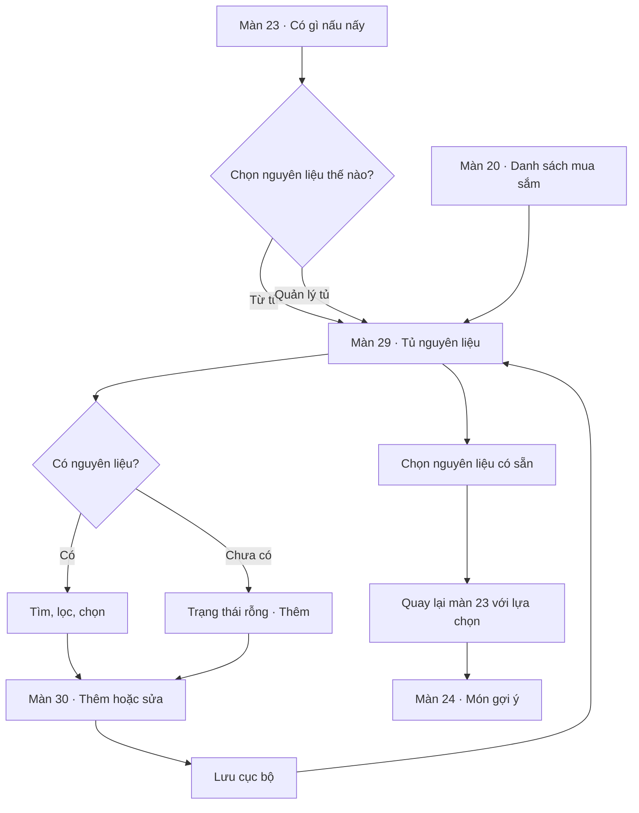
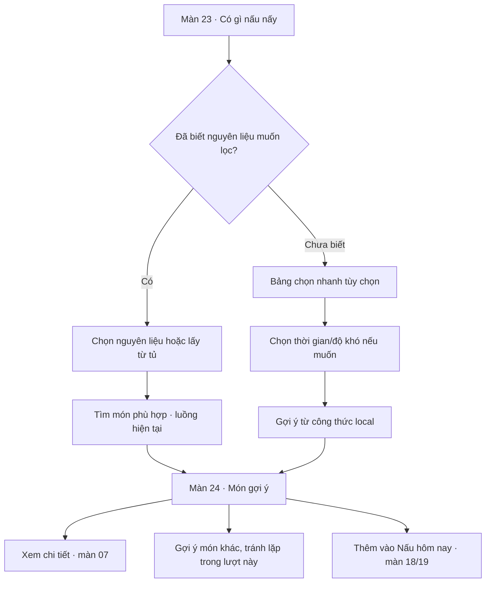
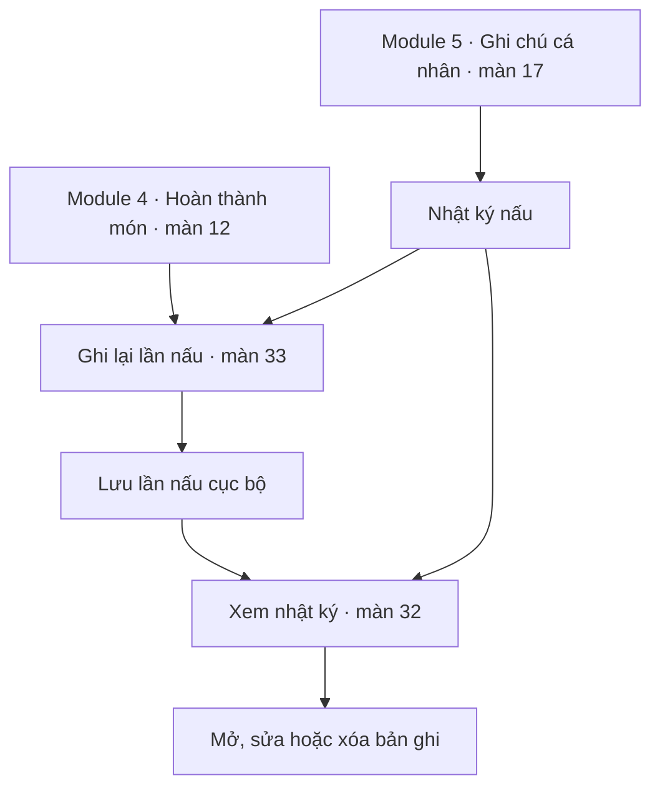

# Bếp nhà · Đề xuất luồng và giao diện cho ba ưu tiên offline

**Ngày:** 21/11/2026  
**Trạng thái:** Hai phần do Người 3 phụ trách (Tủ nguyên liệu và Nhật ký lần nấu) đã được người dùng chọn để triển khai cục bộ trong nhánh hiện tại. Đề xuất “Tối nay nấu gì?” vẫn do Người 1 phụ trách và ngoài phạm vi. Các wireframe dưới đây chưa thay thế prototype 28 màn đã duyệt; schema và tích hợp liên module vẫn cần review.
**Phạm vi:** Android, dữ liệu cá nhân lưu trên thiết bị; không cần đăng nhập/mạng để đọc và sửa dữ liệu cục bộ.

Tài liệu này cụ thể hóa ba ưu tiên đã được người dùng yêu cầu nghiên cứu. Màn 01–28 hiện có vẫn là nguồn thiết kế đã duyệt. Màn 29–33 và các điểm chuyển mới dưới đây là đề xuất; chỉ sau khi nhóm đồng ý mới cập nhật prototype chính thức và kế hoạch module. Không thêm tab đáy thứ năm.

## 1. Chủ sở hữu đề xuất và phối hợp

| Ưu tiên | Người dẫn dắt | Phối hợp | Điểm tích hợp |
| --- | --- | --- | --- |
| Tủ nguyên liệu/hạn dùng | Người 3 — dữ liệu cục bộ, quản lý và kết nối Module 7 | Người 1 so khớp Module 8; Người 2 cung cấp recipe/ingredient catalog offline; người điều phối schema review SQLite | Màn 20/21, 23/24 |
| Gợi ý “Tối nay nấu gì?” | Người 1 — luồng và xếp hạng Module 8 | Người 3 cung cấp pantry/dữ liệu cá nhân phù hợp; Người 2 cung cấp công thức đã tải | Màn 23/24, mở sang màn 07 hoặc 18/19 |
| Nhật ký lần nấu | Người 3 — mở rộng Module 5 và lưu cục bộ | Người 2 cung cấp bước nấu và điểm chuyển hoàn thành Module 4; người điều phối schema review SQLite | Màn 17; điểm vào tùy chọn từ màn 12 |

Phân vai này chỉ áp dụng cho các đề xuất, không đổi phân công hiện hành chín module. Người dùng đã chọn triển khai hai phần Người 3; việc đó không tự thay đổi phân công hoặc hợp đồng schema/navigation dùng chung. Mã/schema/navigation dùng chung vẫn cần review theo quy tắc nhóm.

## 2. Đồng bộ với hệ giao diện hiện tại

Đối chiếu [hệ thiết kế](he-thiet-ke.png), [màn 17](screens/17.png), [màn 20](screens/20.png), [màn 23](screens/23.png) và [màn 24](screens/24.png).

- Giữ nền kem `#FAF9F6`, bề mặt trắng, xanh chính `#326C4F`, nền xanh nhạt `#E8F2E9`, chữ `#25352D`, chữ phụ `#58665C`.
- Tái sử dụng tiêu đề, ô tìm kiếm, chip, thẻ viền nhạt, nút CTA xanh và trạng thái rỗng đang có. Không tự thêm màu/icon mới.
- Lề thiết kế 24 dp; nhịp 8/16/24/32 dp; CTA tối thiểu 48 dp; vùng chạm tối thiểu 48 × 48 dp. 393 × 852 dp là mốc đối chiếu chứ không phải kích thước cố định.
- Danh sách và form cuộn dọc. Khi bàn phím mở, trường đang sửa và nút Lưu vẫn tới được; CTA không che nội dung. Hàng thẻ chuyển hai dòng khi màn hẹp/cỡ chữ lớn.
- Chỉ hiển thị công thức đã lưu local. Nếu nội dung chưa tải, báo cần cập nhật kho khi có mạng; không dựng công thức hoặc lượng giả.

## 3. Ưu tiên 1 — Tủ nguyên liệu và hạn sử dụng

### Luồng



Từ Module 7 có thể mở màn quản lý. Chuyển một dòng mua sắm thành nguyên liệu đã có không tự sửa lượng trong tủ; người dùng cần xác nhận thao tác đó.

### Màn đề xuất 29 — Tủ nguyên liệu

```text
‹  Tủ nguyên liệu                                      [+]
[ Tìm nguyên liệu                              🔍 ]
[Tất cả] [Sắp hết hạn] [Đã hết]

Rau củ
┌─────────────────────────────────────────────┐
│ Cà chua                              [Sửa]  │
│ 4 quả · Dùng trước 24/11                    │
└─────────────────────────────────────────────┘
┌─────────────────────────────────────────────┐
│ Rau thơm                             [Sửa]  │
│ Vừa đủ · Chưa có ngày hết hạn               │
└─────────────────────────────────────────────┘

                         [ + Thêm nguyên liệu ]
```

- Thẻ có tên, lượng/đơn vị nếu biết, ngày hết hạn nếu người dùng nhập và nút sửa. Nhãn hết hạn dùng màu cảnh báo hiện có; ngày chưa biết thì không suy ra.
- Chip lọc giữ từ khóa tìm kiếm. Trạng thái rỗng: `Tủ nguyên liệu đang trống`, lời giải thích ngắn và CTA `Thêm nguyên liệu`.
- **Đã triển khai trong nhánh Người 3:** danh sách có tìm kiếm tên/nhóm/vị trí, chip lọc `Tất cả`, `Sắp hết hạn`, `Hết hạn`; thẻ hiển thị lượng/đơn vị, nhóm, hạn và vị trí; có thêm/sửa/xóa.
- **Mốc tạm dùng trong code:** `Sắp hết hạn` là từ hôm nay đến hết 3 ngày lịch tới; ngày trước hôm nay là `Hết hạn`. Đây là lựa chọn vận hành để bộ lọc có hành vi xác định, chưa phải tiêu chuẩn nghiệp vụ được cả nhóm phê duyệt. Chưa có thông báo hệ thống.

### Màn đề xuất 30 — Thêm/Sửa nguyên liệu

```text
‹  Thêm nguyên liệu
Nguyên liệu *
[ Tìm và chọn nguyên liệu                         ]
Số lượng (không bắt buộc)       Đơn vị
[ 1,5                         ] [ Chọn đơn vị v ]
Hạn sử dụng (không bắt buộc)
[ Chọn ngày                                      ]
Nơi cất (không bắt buộc)
[ Ví dụ: Ngăn mát                               ]
                         [ Lưu nguyên liệu ]
```

- Ưu tiên chọn từ danh mục chuẩn bằng `ingredientId`; có thể cho nhập tên tự do nhưng không dùng tự động để khớp công thức cho tới khi có ánh xạ rõ ràng.
- Lượng lưu chính xác dạng decimal; để trống nghĩa là “có nhưng chưa biết lượng”, khác số 0. Đơn vị theo danh mục K.4, không tự đổi g ↔ ml.
- Hạn sử dụng và nơi cất không bắt buộc. Xóa bản ghi pantry không xóa công thức hay nhật ký nấu.
- `Lưu nguyên liệu` tối thiểu 48 dp; khi IME mở form vẫn cuộn tới được.

### Quy tắc dữ liệu và nối với mua sắm

- Bản ghi cục bộ đề xuất `PantryItem`: `pantryItemId`, `ingredientId` nullable, `nameSnapshot`, `amountDecimal` nullable, `unitId` nullable, `expiryDate` nullable, `storageLocation` nullable, `updatedAt`.
- Cùng `ingredientId`, `unitId` và quy tắc đơn vị Modules 3/7/8. Tên tự do chưa ánh xạ chỉ dùng để hiển thị/tìm.
- Chỉ so lượng khi cùng `ingredientId` và đơn vị tương thích. Thiếu lượng hoặc đơn vị không tương thích thì báo chưa đủ dữ liệu/đối chiếu có-không; không suy đoán.
- Không tự giảm lượng sau khi nấu. Tương tác Module 7 chỉ bù trừ pantry khi hợp đồng lượng/đơn vị đã duyệt; hiển thị rõ `Đã có trong tủ: X` và `Cần mua: Y`, không tự đổi quy tắc hai trạng thái mua sắm.
- Dữ liệu hiện nhập tên tự do và để `ingredientId` trống vì chưa có kho nguyên liệu chuẩn. Không gộp các dòng có tên giống nhau, không tự ghép với công thức và chưa bù trừ Module 7. Cần nhóm chốt khóa nguyên liệu, nhắc hạn, gộp dòng và hành vi bù trừ trước khi tích hợp tự động.

## 4. Ưu tiên 2 — Gợi ý “Tối nay nấu gì?” offline

### Luồng



### Điểm vào màn 23 và bảng chọn nhanh

Giữ lựa chọn nguyên liệu hiện tại. Thêm liên kết phụ nhỏ phía trên CTA `Tìm món phù hợp`: `Không biết chọn món?` → `Gợi ý món tối nay`. Không bắt buộc nhập nguyên liệu.

```text
Gợi ý món tối nay
Chọn tiêu chí nếu bạn muốn
Thời gian       [ Không giới hạn v ]
Độ khó          [ Bất kỳ v ]
Nguyên liệu     [ Dùng tủ nguyên liệu v ]
                  [ Gợi ý món ]
```

Các bộ lọc là tùy chọn; mặc định dùng tất cả công thức đã lưu local. Giá trị cụ thể phải khớp dữ liệu thật của Module 3.

### Màn 24 — Món gợi ý (bổ sung đề xuất)

```text
‹  Món gợi ý
3 món phù hợp với bạn
┌─────────────────────────────────────────────┐
│ [Ảnh món]                                   │
│ Canh chua cá                                │
│ Phù hợp vì bạn đã có 4/5 nguyên liệu        │
│ Còn thiếu: Cá · 30 phút · Dễ                │
│ [ Xem chi tiết ]                            │
└─────────────────────────────────────────────┘
┌─────────────────────────────────────────────┐
│ Thẻ món tiếp theo cùng cấu trúc             │
└─────────────────────────────────────────────┘
                 [ Gợi ý món khác ]
```

- Tái sử dụng thẻ ảnh món hiện có. Mỗi thẻ có một lý do gợi ý ngắn, nguyên liệu có/thiếu, thời gian/độ khó và mở chi tiết.
- Hiện tối đa ba gợi ý đầu; danh sách cuộn. `Gợi ý món khác` không lặp `recipeId` trong lượt hiện tại nếu còn lựa chọn.
- Không có kết quả thì dùng trạng thái `Không có món phù hợp`, cho phép nới bộ lọc hoặc quay lại chọn nguyên liệu.

### Quy tắc xếp hạng đề xuất

1. Loại món chưa có nội dung công thức cần thiết trên máy; áp dụng bộ lọc người dùng chọn.
2. Nếu có danh sách nguyên liệu: giữ thứ tự Module 8 đã thống nhất — ít nguyên liệu thiếu → độ khó dễ đến khó → thời gian ngắn đến dài → tên không dấu → `recipeId`.
3. Yêu thích/lịch sử dùng làm bộ lọc hoặc lời giải thích/đa dạng gợi ý; không đổi thứ tự hiện hành nếu chưa được nhóm duyệt. Có thể tránh lặp trong một lượt gợi ý.
4. Không có pantry thì gợi ý từ kho công thức local và bộ lọc tùy chọn; không khẳng định món “dùng nguyên liệu đang có”. Không dùng AI/server.

## 5. Ưu tiên 3 — Nhật ký lần nấu trong Module 5

### Luồng



Điểm vào từ màn 12 là tùy chọn và cần Người 2 đồng thuận. Màn 17 vẫn là điểm vào thuộc Module 5. Nhật ký ghi nhiều sự kiện cho một món; không thay thế ghi chú chung đang lưu trong `RecipeNote`.

### Mở rộng màn 17 — Ghi chú cá nhân

Giữ nội dung công thức/cách nấu sau khi module phụ trách cung cấp dữ liệu, ô `Ghi chú sau khi nấu` và nút `Lưu ghi chú`. Cuộn xuống dưới phần hiện tại để thêm:

```text
Nhật ký nấu                               Xem tất cả ›
Đã nấu 3 lần
┌─────────────────────────────────────────────┐
│ 20/11 · 2 người · ★★★★☆                   │
│ Lần sau giảm bớt me                         │
└─────────────────────────────────────────────┘
[ + Ghi lại lần nấu ]
```

Khi chưa có bản ghi: `Bạn chưa ghi lại lần nấu nào` và CTA `Ghi lại lần nấu`. Không thay nút lưu ghi chú hoặc hiển thị giả trạng thái đã lưu.

### Màn 32 — Nhật ký món ăn

```text
‹  Nhật ký nấu
[Ảnh món]  Canh chua cá
           Đã nấu 3 lần
┌─────────────────────────────────────────────┐
│ 20/11/2026                                  │
│ 2 người · 42 phút · ★★★★☆                 │
│ Giảm me, cho rau thơm sau khi tắt bếp.      │
│                                  [Mở ›]     │
└─────────────────────────────────────────────┘
                 [ + Ghi lại lần nấu ]
```

Sắp xếp mới nhất trước. Không có ảnh thì giữ thứ bậc thông tin và bố cục thẻ. Trạng thái rỗng dùng câu hướng dẫn và CTA.

### Màn 33 — Ghi lại lần nấu

```text
‹  Ghi lại lần nấu
[Ảnh món]  Canh chua cá
Ngày nấu *                  Khẩu phần *
[ Hôm nay v ]              [ 2 người -  + ]
Thời gian thực tế (không bắt buộc)
[ 42 ] phút
Bạn đánh giá món này
[ ☆  ☆  ☆  ☆  ☆ ]
Điều chỉnh lần này (không bắt buộc)
[ Ví dụ: giảm me, thêm rau thơm...           ]
Ảnh món đã nấu (không bắt buộc)
[ + Thêm ảnh ]
                         [ Lưu lần nấu ]
```

- Nếu mở từ màn 12, điền sẵn ngày, khẩu phần và thời gian phiên nếu có; từ màn 17 dùng ngày hiện tại và khẩu phần hiện tại. Cho phép sửa trước khi lưu.
- Thời lượng, đánh giá, điều chỉnh và ảnh không bắt buộc. Không bắt nhập lại công thức/bước.
- Chỉ xin quyền ảnh lúc người dùng chọn ảnh; lưu ảnh trong bộ nhớ nội bộ app. Xóa bản ghi phải dọn file tương ứng an toàn.
- **Đã triển khai trong nhánh Người 3:** từ màn 17 mở nhật ký của đúng món; xem trước hai lần gần nhất; thêm/sửa/xóa từng lần; lưu ngày, khẩu phần, thời gian tùy chọn, đánh giá tùy chọn, điều chỉnh và ảnh cục bộ. Lưu xong quay về nhật ký của món đó; không tự chuyển tab.
- Ảnh được sao chép vào vùng riêng tư của app, giới hạn hiện tại 10 MiB mỗi ảnh và xóa cùng bản ghi/ảnh được thay. Giới hạn này là chính sách triển khai hiện tại, chưa phải quyết định chung về retention/backup.

### Dữ liệu và ranh giới

- Bản ghi đề xuất `CookingLog`: `logId`, `recipeId`, `cookedAt`, `servings`, `actualDurationMinutes` nullable, `rating` nullable, `adjustmentNote` nullable, `photoLocalPath` nullable, `createdAt`, `updatedAt`.
- Nhật ký không ghi đè công thức, bước nấu hoặc ghi chú chung. Chỉ lưu trên thiết bị; không đồng bộ Firebase trong phạm vi offline.
- Nhật ký hiện gắn `recipeId` cùng snapshot tiêu đề/ảnh sẵn có; chưa lưu snapshot phiên bản công thức. Chưa có backup, đồng bộ hoặc sự kiện tự động từ Module 4; điểm nối đó cần Người 2 và nhóm thống nhất.

## 6. Responsive và tiêu chí hoàn thiện thiết kế

- Danh sách dài cuộn dọc; CTA đáy chỉ dùng cho thao tác chính và không che nội dung/IME.
- Thẻ pantry và nhật ký được phép chuyển thành hai hàng trên màn hẹp hoặc cỡ chữ lớn; không ép tên, lượng, ngày và action vào cùng một hàng.
- Đặc tả trạng thái rỗng, không có kết quả, thiếu lượng/ngày, hết hạn, công thức chưa tải local, không có món phù hợp, nhật ký trống, lỗi lưu/xóa và quyền ảnh bị từ chối.
- Sau khi nhóm duyệt, cập nhật danh mục màn/luồng trong `THIET_KE.md`, tạo mockup/PNG cùng hệ màu/font/spacing và kiểm tra viewport nhỏ/lớn/IME. Trước khi duyệt, đây là wireframe văn bản, không phải thay đổi prototype 28 màn.

## 7. Cần thống nhất trước khi tích hợp và hoàn thiện

1. Người điều phối schema review migration SQLite mới (schema 8) và hợp đồng khóa trước khi merge.
2. Xác nhận mốc “sắp hết hạn” 3 ngày tạm dùng và có cần thông báo cục bộ không.
3. Người 2 cung cấp ingredientId/danh mục nguyên liệu và phối hợp quy tắc gộp/bù trừ Module 7.
4. Người 2 xác nhận điểm vào từ Module 4; nhóm quyết định có cần snapshot phiên bản công thức, backup và retention ảnh/nhật ký không.
5. Hạng mục “Tối nay nấu gì?” vẫn chờ Người 1 triển khai theo phần phân công; không thuộc thay đổi hiện tại.

