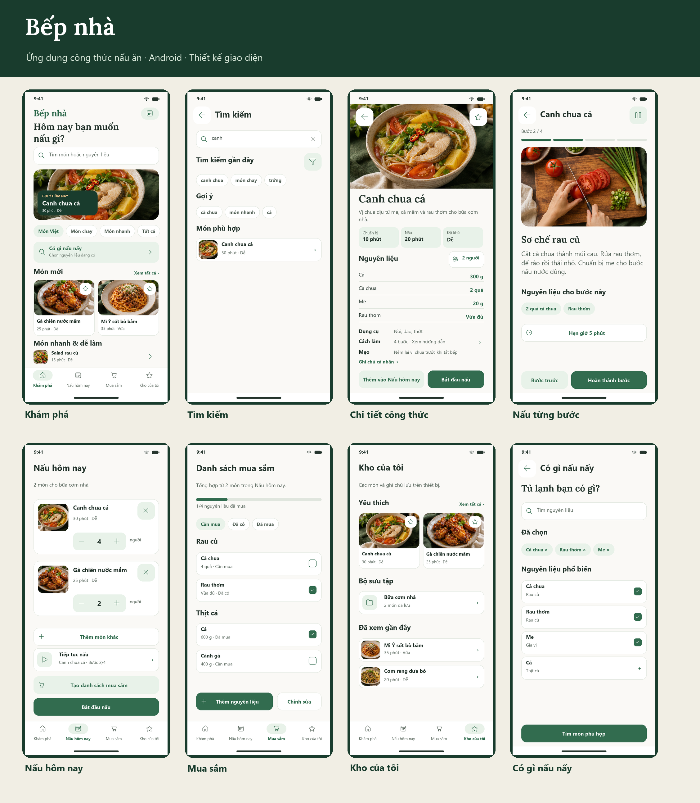

# Bếp nhà · Bàn giao thiết kế Android

**Bếp nhà** là tên hiển thị đề xuất. Thiết kế tiếng Việt bao phủ chín module, với bốn mục chính **Khám phá**, **Nấu hôm nay**, **Mua sắm** và **Kho của tôi**. Người dùng vào thẳng kho công thức. Nội dung công khai được cập nhật từ Firebase, còn kho món cá nhân và phiên nấu thuộc thiết bị.

- [Hệ thiết kế](he-thiet-ke.png) · [Showcase](showcase.png) · [Sơ đồ luồng A–F](luong-a-f.png)
- [Prototype PDF](prototype.pdf) · [Màn 01–07](man-hinh-1.png) · [Màn 08–14](man-hinh-2.png) · [Màn 15–21](man-hinh-3.png) · [Màn 22–28](man-hinh-4.png)
- [Wireframe đề xuất cho ba ưu tiên offline (chưa duyệt)](DE_XUAT_TINH_NANG_OFFLINE.md)

Mở PDF bằng trình đọc hỗ trợ liên kết nội bộ. Chạm các nút trong những luồng mẫu hoặc dùng mục lục trang để chuyển màn. PDF mô phỏng trạng thái bằng ảnh tĩnh và liên kết. Đồng hồ, tìm kiếm, đồng bộ và thay đổi dữ liệu được minh họa qua các trạng thái có sẵn.

## Danh mục màn hình

| Màn | Module | Ảnh PNG |
| --- | --- | --- |
| 01 | 1 | [Khám phá](screens/01.png) |
| 02 | 1 | [Danh mục món ăn](screens/02.png) |
| 03 | 1 | [Món mới](screens/03.png) |
| 04 | 2 | [Tìm kiếm](screens/04.png) |
| 05 | 2 | [Bộ lọc nâng cao](screens/05.png) |
| 06 | 2 | [Kết quả tìm kiếm](screens/06.png) |
| 07 | 3 | [Chi tiết công thức](screens/07.png) |
| 08 | 3 | [Điều chỉnh khẩu phần](screens/08.png) |
| 09 | 4 | [Nấu từng bước](screens/09.png) |
| 10 | 4 | [Hẹn giờ](screens/10.png) |
| 11 | 4 | [Tiếp tục nấu](screens/11.png) |
| 12 | 4 | [Hoàn thành món](screens/12.png) |
| 13 | 5 | [Kho của tôi](screens/13.png) |
| 14 | 5 | [Yêu thích](screens/14.png) |
| 15 | 5 | [Bộ sưu tập](screens/15.png) |
| 16 | 5 | [Tạo hoặc sửa bộ sưu tập](screens/16.png) |
| 17 | 5 | [Ghi chú cá nhân](screens/17.png) |
| 18 | 6 | [Nấu hôm nay](screens/18.png) |
| 19 | 6 | [Thêm món vào kế hoạch](screens/19.png) |
| 20 | 7 | [Danh sách mua sắm](screens/20.png) |
| 21 | 7 | [Thêm hoặc sửa nguyên liệu](screens/21.png) |
| 22 | 7 | [Xác nhận cập nhật mua sắm](screens/22.png) |
| 23 | 8 | [Có gì nấu nấy](screens/23.png) |
| 24 | 8 | [Món gợi ý](screens/24.png) |
| 25 | 9 | [Offline có dữ liệu](screens/25.png) |
| 26 | 9 | [Đang cập nhật](screens/26.png) |
| 27 | 9 | [Có món mới](screens/27.png) |
| 28 | 9 | [Công thức bị gỡ](screens/28.png) |

## Biến thể và trạng thái

- **Ví dụ chuyển trạng thái** · [Chi tiết sau khi đổi sang 4 người](states/chi-tiet-4-nguoi.png) · [Nấu bước 3](states/nau-buoc-3.png) · [Nấu bước 4](states/nau-buoc-4.png).

- **Kho công thức** · [Lần đầu đang tải](states/khoi-dong.png) · [Offline lần đầu](states/offline-lan-dau.png) · [Lỗi cập nhật](states/loi-cap-nhat.png) · [Danh sách theo danh mục](states/danh-sach-danh-muc.png).
- **Tìm và chọn nguyên liệu** · [Không có kết quả](states/khong-ket-qua.png) · [Chưa chọn nguyên liệu](states/chua-chon-nguyen-lieu.png) · [Không có món phù hợp](states/khong-co-mon-phu-hop.png).
- **Chi tiết và nấu** · [Khẩu phần không hợp lệ](states/khau-phan-loi.png) · [Danh sách các bước](states/chi-tiet-cac-buoc.png) · [Chọn món để nấu](states/chon-mon-de-nau.png) · [Hẹn giờ sẵn sàng](states/hen-gio-san-sang.png) · [Đang chạy](screens/10.png) · [Tạm dừng](states/hen-gio-tam-dung.png) · [Hết giờ](states/hen-gio-xong.png) · [Phiên đang dở](screens/11.png).
- **Dữ liệu cá nhân** · [Yêu thích trống](states/yeu-thich-trong.png) · [Bộ sưu tập trống](states/bo-suu-tap-trong.png) · [Tên bộ sưu tập trùng](states/bo-suu-tap-loi.png) · [Kế hoạch trống](states/ke-hoach-trong.png) · [Mua sắm trống](states/mua-sam-trong.png) · [Đã mua đủ](states/da-mua-het.png).

## Điều hướng và điểm chuyển

| Luồng | Điểm chuyển chính | Điểm quay lại hoặc kết quả |
| --- | --- | --- |
| A. Tìm và nấu một món | [01](screens/01.png) → [04](screens/04.png) → [07](screens/07.png) → [08](screens/08.png) → [09](screens/09.png) → [10](screens/10.png) → [12](screens/12.png) | Xác nhận khẩu phần về chi tiết. Hẹn giờ về bước nấu. Hoàn thành về Khám phá hoặc công thức. |
| B. Lên kế hoạch bữa ăn | [07](screens/07.png) → [19](screens/19.png) → [18](screens/18.png) → [20](screens/20.png) → [22](screens/22.png) | Thêm món thứ hai từ Nấu hôm nay. Mua sắm quay về kế hoạch qua thanh điều hướng. |
| C. Chọn món theo nguyên liệu | [01](screens/01.png) → [23](screens/23.png) → [24](screens/24.png) → [07](screens/07.png) → [19](screens/19.png) | Quay lại sửa nguyên liệu hoặc thêm món vào kế hoạch. |
| D. Quản lý món đã lưu | [07](screens/07.png) → [13](screens/13.png) → [15](screens/15.png) → [16](screens/16.png) → [07](screens/07.png) → [17](screens/17.png) | Lưu bộ sưu tập rồi mở món. Lưu ghi chú và quay về chi tiết. |
| E. Tiếp tục nấu | [09](screens/09.png) → [11](screens/11.png) → [18](screens/18.png) → [11](screens/11.png) → [09](screens/09.png) | Tạm dừng, quay lại Nấu hôm nay và mở phiên đang dở. |
| F. Offline và cập nhật | [01](screens/01.png) → [25](screens/25.png) → [07](screens/07.png) → [26](screens/26.png) → [27](screens/27.png) → [03](screens/03.png) | Hiển thị nội dung đã tải khi offline. Dùng Thử lại để mô phỏng kết nối lại trong PDF. |

## Thông số dùng chung

- Khung **393 × 852 dp**, PNG xuất **786 × 1704 px**. Thanh trạng thái 34 dp. Điều hướng chính từ y=758 đến 828 dp. Vùng thao tác hệ thống ở đáy 24 dp.
- Lề nội dung 24 dp. Nhịp khoảng cách 8 dp, dùng 16, 24 và 32 dp cho các cụm nội dung. Nút chính cao 48 dp. Các icon nhỏ dùng vùng chạm tối thiểu 48 dp khi triển khai. Thẻ và bảng trượt bo 12–25 dp.
- Font mockup dùng **Lora** cho tiêu đề nổi bật và **Segoe UI** cho chữ giao diện. Có thể đối chiếu với Roboto hoặc Be Vietnam Pro khi triển khai Android. Cỡ tiêu biểu gồm display 25–30, tiêu đề màn 23, heading 19, body 14–16, label 13–14 và caption 11–12.
- Màu chính **#326C4F**, nền xanh **#E8F2E9**, cam đất **#F2A65A**, nền kem **#FAF9F6**, bề mặt **#FFFFFF**, chữ **#25352D**, chữ phụ **#58665C**, lỗi **#A93636**. Xanh chính và chữ phụ được làm đậm so với màu gợi ý.
- Dùng chung thẻ món, thẻ nổi bật, thẻ danh mục, ô tìm kiếm, chip lọc/nguyên liệu, dòng nguyên liệu, checklist, khối bước nấu, bộ đếm khẩu phần, đồng hồ, chỉ báo tiến độ, thanh tiêu đề/điều hướng, bảng trượt, xác nhận, thông báo, trạng thái trống/đang tải/offline.
- Các ảnh món được tạo bằng ImageGen tích hợp từ một lưới ảnh 3 × 3. Nội dung ảnh gồm phở bò, bún chả, canh chua cá, gà chiên nước mắm, cơm rang dưa bò, mì Ý sốt bò bằm, salad, pancake và cảnh sơ chế cà chua. Phong cách ảnh ẩm thực editorial, ánh sáng cửa sổ, không chữ hoặc nhãn hiệu. Ảnh, định lượng và thời gian trong mockup dùng minh họa giao diện.

## Đề xuất mở rộng offline — prototype 28 màn vẫn là chuẩn hiện hành

Ba hạng mục — Tủ nguyên liệu/hạn sử dụng, gợi ý “Tối nay nấu gì?” offline và Nhật ký lần nấu — có luồng, wireframe văn bản, điểm vào, chủ sở hữu đề xuất và ranh giới dữ liệu riêng trong [DE_XUAT_TINH_NANG_OFFLINE.md](DE_XUAT_TINH_NANG_OFFLINE.md). Người dùng đã yêu cầu triển khai hai hạng mục Người 3 (Tủ nguyên liệu và Nhật ký lần nấu) ở mức lưu cục bộ; “Tối nay nấu gì?” vẫn thuộc Người 1. Việc triển khai không thay thế prototype 28 màn, không thêm tab điều hướng và chưa đồng nghĩa nhóm đã duyệt wireframe thành thiết kế chính thức. Giao diện mới phải tiếp tục đối chiếu hệ màu, khoảng cách, thẻ và hành vi responsive hiện có.

## Giả định cần xác nhận khi đặc tả

| Chủ đề | Phương án thể hiện |
| --- | --- |
| Món mới | Sắp xếp theo thời điểm công bố. Việc chỉnh sửa không đưa món cũ lên nhóm món mới. |
| Khẩu phần | Nhận số nguyên dương. Lượng định tính giữ nguyên. Thời gian nấu giữ nguyên. Cần chốt ngưỡng tối đa và cách làm tròn. |
| Kế hoạch và mua sắm | Một món đã có được đánh dấu khi chọn lại. Khi đổi khẩu phần, người dùng có thể giữ danh sách cũ hoặc cập nhật mục từ công thức và giữ mục thủ công. Chốt cách giữ trạng thái của mục đã mua hoặc đã chỉnh tay. Chỉ quy đổi đơn vị cùng loại. |
| Bộ sưu tập | Ví dụ dùng kiểm tra tên rỗng và trùng. Chốt cách chuẩn hóa dấu cách, chữ hoa/thường và phạm vi kiểm tra. |
| Phiên nấu và hẹn giờ | Prototype dùng một phiên mẫu. Cần chốt quy tắc nhiều hẹn giờ, thông báo nền và khôi phục khi hệ điều hành đóng app. |
| Nguyên liệu có sẵn | Đối chiếu có/không. Ưu tiên món thiếu ít nguyên liệu. Cần chốt thứ tự khi đồng hạng. |
| Món bị gỡ | Giữ và cho mở ghi chú cá nhân. Cần chốt hành vi với yêu thích, danh sách mua sắm và phiên đang nấu. |

